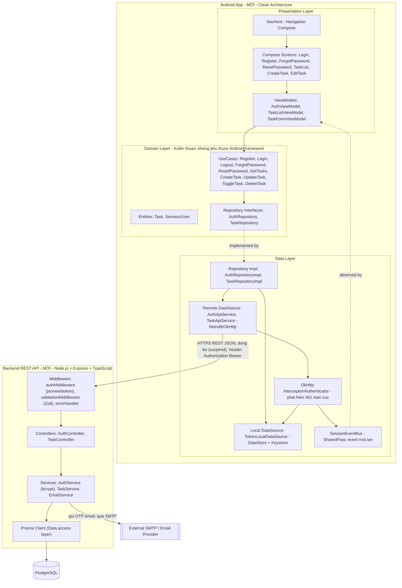
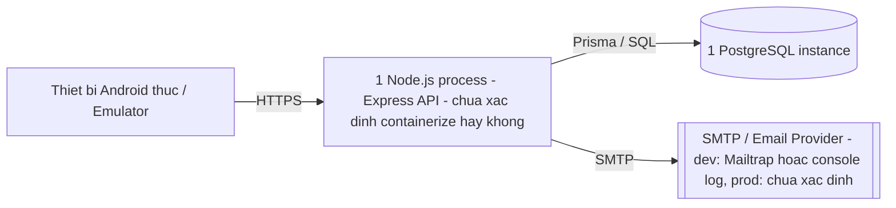

# High-Level Design: Ứng dụng Android Quản lý Task/To-Do (CRUD) — Full-Stack

| | |
|---|---|
| **Dự án** | Full-Stack Assessment — Task 2: Task/To-Do CRUD Management |
| **Phiên bản** | 1.0 |
| **Ngày tạo** | 2026-10-14 |
| **Nguồn yêu cầu** | `docs/SRS_ToDo_Android.md` (v1.0) |
| **Trạng thái** | Draft — chờ review stakeholder trước khi chuyển cho `low-level-designer` |

## Phương án kiến trúc đã chốt

- **Backend**: Node.js + Express + TypeScript, PostgreSQL, Prisma ORM, kiến trúc
  layer Controller → Service → Prisma/Repository.
- **Android**: Jetpack Compose (không XML), Clean Architecture 3 layer
  (Presentation / Domain / Data), DI bằng Hilt, hoạt động **online-only**
  (không Room/cache Task, chỉ lưu JWT cục bộ).
- **Nguồn chốt**: Người dùng tự chốt trực tiếp, chỉ định thư viện cụ thể cho
  từng phần. Các chỉ định thư viện này được giữ nguyên, không tự đổi.

## Bối cảnh hệ thống hiện tại (đã khảo sát)

- Module/service liên quan đã tồn tại: **Không có.** Repo chỉ chứa
  `Task2_Task_ToDo_CRUD.pdf` và `docs/SRS_ToDo_Android.md`. Toàn bộ thành
  phần Backend và Android trong tài liệu này là **MỚI**, cần xây từ đầu.
- Pattern giao tiếp hiện có: chưa có (chưa triển khai code nào).
- Hạ tầng deployment hiện có: chưa có Dockerfile/k8s manifest/config cloud
  nào trong repo → mọi mô tả deployment ở mục dưới ghi rõ "chưa xác định"
  khi không có cơ sở suy luận.

---

## 1. Sơ đồ thành phần

### 1.1 Sơ đồ tổng thể

### 1.2 Ghi chú về biên giới

- Android App và Backend API là hai hệ thống/tiến trình độc lập, giao tiếp
  duy nhất qua REST API (mục 6 trong SRS) — không có kênh giao tiếp khác
  (không gRPC, không shared DB).
- `SessionEventBus` là một class Kotlin thuần (không phụ thuộc Android
  framework) đặt ở một module "core"/dùng chung, được cả tầng Data
  (Interceptor) và tầng Presentation (ViewModel/NavHost quan sát) tiêm vào
  qua Hilt dưới dạng Singleton — đây là cách cầu nối sự kiện 401 toàn cục mà
  không làm Domain phụ thuộc vào OkHttp hay Presentation phụ thuộc trực tiếp
  vào Data.
- Backend không có tầng "Repository" riêng biệt tách khỏi Service (Prisma
  Client đóng vai trò data access trực tiếp trong Service) — đây là lựa
  chọn hợp lý với Prisma (đã có type-safe query builder), không cần thêm
  abstraction Repository thủ công ở mức HLD; nếu `low-level-designer` thấy
  cần tách Repository riêng để dễ test/mocking, đó là quyết định LLD, không
  mâu thuẫn với HLD này.

---

## 2. Trách nhiệm từng thành phần (kèm đề xuất thư viện)

### Android — Presentation Layer (MỚI)
- **Làm**: Hiển thị UI bằng Jetpack Compose cho 7 màn hình (Login, Register,
  ForgotPassword, ResetPassword, TaskList, CreateTask, EditTask); giữ và
  expose UI state (loading/success/error/empty) qua `StateFlow` từ
  ViewModel (`androidx.lifecycle:lifecycle-viewmodel-compose`); điều hướng
  giữa màn hình bằng **Navigation Compose**; nhận sự kiện 401 toàn cục từ
  `SessionEventBus` để điều hướng về Login.
- **Không làm**: Không gọi trực tiếp Retrofit/API; không chứa business
  logic (validate nghiệp vụ, quyết định gọi UseCase nào) — việc đó thuộc
  ViewModel gọi xuống Domain.
- **Thư viện**: Jetpack Compose, `androidx.lifecycle:lifecycle-viewmodel-ktx`,
  Kotlin Coroutines (`StateFlow`/`SharedFlow`), Navigation Compose
  (`androidx.navigation:navigation-compose`).
- **Biên giới**: Gọi xuống Domain Layer (UseCase) qua ViewModel; không giao
  tiếp trực tiếp với Data Layer.

### Android — Domain Layer (MỚI, Kotlin thuần)
- **Làm**: Chứa UseCase (mỗi UseCase = một hành vi nghiệp vụ: đăng ký, đăng
  nhập, lấy danh sách task có filter, tạo/sửa/toggle/xóa task...), Entity
  (`Task`, `Session`/`User`) và Repository interface (`AuthRepository`,
  `TaskRepository`). Validate nghiệp vụ phía client (title không rỗng, email
  format, password rule) có thể đặt ở UseCase hoặc chia sẻ với Presentation
  tùy LLD quyết định.
- **Không làm**: Không phụ thuộc Android framework (không import
  `android.*`), không biết Retrofit/DataStore là gì — chỉ biết interface.
  Không bao giờ chứa code UI hoặc network.
- **Thư viện**: Kotlin thuần (coroutines core, không cần Android
  dependency) — mục đích để unit test nhanh không cần Android instrumented.
- **Biên giới**: Được gọi bởi Presentation; gọi xuống Data Layer qua
  Repository interface (không biết implementation cụ thể).

### Android — Data Layer (MỚI)
- **Làm**: Hiện thực Repository interface; gọi network qua **Retrofit +
  OkHttp**; parse JSON; đọc/ghi JWT token cục bộ; gắn header Authorization
  tự động cho mọi request `/tasks/*`; phát hiện `401` toàn cục và emit sự
  kiện qua `SessionEventBus`.
- **Không làm**: Không chứa UI state, không quyết định điều hướng màn hình
  (chỉ emit sự kiện, Presentation quyết định điều hướng cụ thể).
- **Thư viện cụ thể**:
  - Networking: **Retrofit2 + OkHttp3**, interceptor logging riêng cho môi
    trường dev.
  - JSON parsing: **kotlinx.serialization** (đề xuất chính) — lý do: tích
    hợp sẵn converter chính thức cho Retrofit
    (`retrofit2-kotlinx-serialization-converter`), không cần reflection
    (code-gen tại compile-time qua Kotlin compiler plugin), nhẹ, đồng bộ
    tốt với `data class`/`sealed class` Kotlin thuần ở Domain. **Phương án
    thay thế hợp lệ**: Moshi (+ `moshi-kotlin-codegen` để tránh reflection)
    — ưu điểm sinh thái lâu đời hơn, nhiều adapter custom có sẵn; nhược
    điểm cần thêm annotation `@JsonClass` trên model. Mặc định chọn
    kotlinx.serialization trừ khi team có lý do riêng dùng Moshi.
  - Token local storage: **Jetpack DataStore (Preferences)** kết hợp
    **`androidx.security:security-crypto` (EncryptedSharedPreferences/
    Android Keystore)** để JWT không lưu plaintext trên thiết bị (đáp ứng
    NFR-3 trong SRS).
  - Phát hiện 401 toàn cục: **OkHttp `Interceptor`** (hoặc `Authenticator`
    nếu cần logic refresh-token trong tương lai — SRS chưa có refresh
    token, nên dùng Interceptor đơn giản là đủ ở v1).
- **Biên giới**: Hiện thực interface từ Domain; giao tiếp ra ngoài biên giới
  Android App qua HTTPS tới Backend API.

### Android — Dependency Injection (MỚI)
- **Làm**: Cung cấp instance Retrofit/OkHttpClient, DataStore, Repository
  impl, UseCase, ViewModel qua **Hilt** (`@HiltAndroidApp`,
  `@HiltViewModel`, các `@Module` cho Network/DataStore/Repository).
- **Không làm**: Không chứa business logic.
- **Thư viện**: Hilt (`com.google.dagger:hilt-android`).

### Android — Testing (MỚI)
- **Thư viện đề xuất**: **JUnit4** (đề xuất mặc định thay vì JUnit5) — lý
  do: hệ sinh thái AndroidX Test và Compose UI Testing
  (`androidx.compose.ui.test`) hỗ trợ JUnit4 Rule-based testing là first-
  class; JUnit5 (`android-junit5` plugin) khả dụng nhưng cần cấu hình thêm
  cho instrumented test, không cần thiết cho scope dự án này. **MockK** cho
  mock Kotlin (ViewModel, UseCase, Repository). **Turbine** để test luồng
  `StateFlow`/`SharedFlow` (đặc biệt `SessionEventBus`). **Compose UI
  Testing** (`createComposeRule`) cho test giao diện các luồng chính.
- **Biên giới**: Unit test Domain/Presentation không cần thiết bị thật
  (Domain Kotlin thuần, ViewModel dùng fake Repository); Compose UI Test
  cần instrumented/Robolectric tùy LLD quyết định.

### Backend — Web framework (MỚI)
- **Làm**: Định nghĩa route `/auth/*` và `/tasks/*`, áp middleware xác thực
  cho toàn bộ `/tasks/*`, điều phối request tới Controller tương ứng, trả
  response đúng status code theo API Contract (mục 6 SRS).
- **Không làm**: Không chứa business logic trực tiếp trong route handler —
  route handler (Controller) chỉ gọi Service.
- **Thư viện**: Express + TypeScript, cấu trúc thư mục đề xuất
  `src/routes`, `src/controllers`, `src/services`, `src/middlewares`.

### Backend — ORM/Database (MỚI)
- **Làm**: Prisma định nghĩa schema `User`/`Task` đúng Data Model mục 5
  SRS (bao gồm index `ownerId`, enum `status` open/done, `createdAt`/
  `updatedAt` tự động); chạy migration; cung cấp Prisma Client cho Service
  truy vấn có type-safe và tự động enforce `ownerId` trong mọi query/update/
  delete liên quan Task.
- **Không làm**: Không raw SQL trừ khi có lý do đặc biệt (không nêu trong
  SRS).
- **Thư viện**: `prisma` + `@prisma/client`, PostgreSQL driver đi kèm.

### Backend — Auth (MỚI)
- **Làm**: `AuthService` sign/verify JWT bằng **`jsonwebtoken`**; hash mật
  khẩu bằng **`bcrypt`**; `authMiddleware` verify JWT từ header
  `Authorization: Bearer <token>` cho mọi route `/tasks/*`, gắn `userId`
  vào request context để `TaskService` enforce ownership; trả `401` khi
  token không hợp lệ/hết hạn (đáp ứng FR-04).
- **Không làm**: Không tự quản lý session server-side (stateless JWT, không
  session store) — phù hợp với SRS không yêu cầu refresh token.
- **Thư viện**: `jsonwebtoken`, `bcrypt` (hoặc `bcryptjs` nếu cần thuần JS
  không cần native build — quyết định LLD).

### Backend — Validation (MỚI)
- **Làm**: Validate request body (email format, password rule ≥8 ký tự có
  chữ+số, `title` non-empty/trimmed...) bằng **Zod** trước khi vào Service,
  trả `400` kèm message rõ ràng khi fail.
- **Lý do chọn Zod** (đã là lựa chọn mặc định theo chỉ định kiến trúc):
  TypeScript-first, suy ra type từ schema (`z.infer`) giảm trùng lặp định
  nghĩa type giữa validation và DTO, cú pháp khai báo rõ ràng, tích hợp tốt
  với Express middleware pattern.
- **Không làm**: Không validate business rule cần truy DB (ví dụ email đã
  tồn tại) — việc đó ở Service (kiểm tra qua Prisma, trả `409`).

### Backend — Email (MỚI, phục vụ FR-05)
- **Làm**: `EmailService` gửi OTP đặt lại mật khẩu qua email. Đề xuất
  **Nodemailer** với transport SMTP cấu hình qua biến môi trường.
  - **Môi trường dev**: dùng SMTP test (ví dụ Mailtrap) hoặc fallback
    `console.log` nội dung email để không phụ thuộc dịch vụ ngoài khi phát
    triển/test cục bộ.
  - **Môi trường production**: cấu hình SMTP thực hoặc dịch vụ transactional
    email (ví dụ SendGrid/SES — nhà cung cấp cụ thể **chưa xác định**, cần
    stakeholder/đội vận hành chốt khi lên production thật; ngoài phạm vi
    bài tập học thuật/demo).
- **Không làm**: Không tự quản lý template email phức tạp (ngoài phạm vi
  SRS, chỉ cần nội dung chứa OTP).
- Cơ chế lưu OTP (bảng riêng, field trong `User`, TTL cụ thể) **chưa chốt ở
  mức HLD** — để `low-level-designer` quyết định, chỉ cần đảm bảo
  `AuthService` có nơi lưu + kiểm tra hết hạn OTP khi `reset-password`.

### Backend — Testing (MỚI)
- **Thư viện**: **Jest + Supertest** cho unit/integration test API, bao
  phủ đúng 5 Unit Test Scenario (Given/When/Then, mục 7.1 SRS) và các case
  Auth (register/login/forgot/reset) tương ứng FR-01/02/05.

---

## 3. Giao tiếp & luồng dữ liệu

| Từ | Đến | Đồng bộ/Bất đồng bộ | Kênh | Ý nghĩa giao tiếp |
|---|---|---|---|---|
| Compose UI | ViewModel | Đồng bộ (in-process) | Kotlin function call | UI gửi hành động người dùng (nhấn nút, nhập form) |
| ViewModel | UseCase (Domain) | Bất đồng bộ (coroutine suspend) | In-process call | Yêu cầu thực hiện một hành vi nghiệp vụ (đăng ký/đăng nhập/CRUD task) |
| UseCase | Repository interface | Bất đồng bộ (suspend) | In-process call | Domain yêu cầu Data layer thực hiện thao tác dữ liệu, không biết nguồn dữ liệu cụ thể |
| RepositoryImpl | AuthApiService / TaskApiService | Bất đồng bộ (suspend, Retrofit) | HTTPS REST/JSON | Gọi API thực tế tới Backend |
| RepositoryImpl | TokenLocalDataSource | Bất đồng bộ (suspend, DataStore) | In-process, đĩa cục bộ | Đọc/ghi JWT token trên thiết bị |
| OkHttp Interceptor | SessionEventBus | Bất đồng bộ (emit SharedFlow) | In-process event | Thông báo toàn cục "phiên hết hạn" khi phát hiện `401` ở bất kỳ request nào |
| SessionEventBus | ViewModel/NavHost (Presentation) | Bất đồng bộ (collect SharedFlow) | In-process event (one-shot) | Trigger hiển thị thông báo + điều hướng về Login |
| Android App (Retrofit) | Backend API (Express) | Đồng bộ theo từng request (client chờ response), kênh HTTPS | REST/JSON qua internet/LAN | Toàn bộ nghiệp vụ Auth + Task CRUD, theo đúng API Contract SRS mục 6 |
| Express Middleware | Controller → Service | Đồng bộ (in-process) | Function call | Điều phối request đã xác thực/validate tới business logic |
| AuthService | PostgreSQL (qua Prisma) | Đồng bộ (await) | SQL qua Prisma Client | Đọc/ghi `User` (tạo account, kiểm tra credential, lưu OTP, đổi password hash) |
| TaskService | PostgreSQL (qua Prisma) | Đồng bộ (await) | SQL qua Prisma Client | CRUD `Task` có điều kiện `ownerId` enforce ownership |
| EmailService | SMTP/Email Provider | Bất đồng bộ (await gửi, không chờ người nhận đọc) | SMTP | Gửi email chứa OTP đặt lại mật khẩu |

### 3.1 Luồng chính 1: Đăng ký → Đăng nhập → lưu token → gọi Task API

1. `RegisterScreen` → `AuthViewModel`: người dùng nhập email/password/xác
   nhận password, nhấn Đăng ký.
2. `AuthViewModel` → `RegisterUseCase` → `AuthRepository.register()` →
   `AuthRepositoryImpl` → `AuthApiService` → `POST /auth/register`.
3. Backend: `validationMiddleware` (Zod) → `AuthController` →
   `AuthService.register()` (bcrypt hash password) → Prisma tạo `User` →
   trả `201`.
4. **Điểm cần làm rõ** (xem mục Open Questions): API Contract SRS mục 6.2
   không ghi `/auth/register` trả JWT, nhưng AC FR-01 yêu cầu "tự động đăng
   nhập". Giả định mức HLD: sau khi `register` trả `201` thành công, client
   tự động gọi tiếp `POST /auth/login` với cùng credential để lấy JWT, tạo
   cảm giác "tự động đăng nhập" phía người dùng mà không cần nhập lại.
5. `AuthRepositoryImpl` nhận JWT từ response login → `TokenLocalDataSource`
   lưu token vào DataStore + Keystore-encrypted storage.
6. `AuthViewModel` cập nhật state thành công → `NavHost` điều hướng tới
   `TaskListScreen`.
7. `TaskListViewModel` → `GetTasksUseCase` → `TaskRepositoryImpl` →
   `TaskApiService.getTasks()` — OkHttp Interceptor tự động đọc token từ
   `TokenLocalDataSource` và gắn header `Authorization: Bearer <token>` →
   `GET /tasks`.
8. Backend: `authMiddleware` verify JWT → `TaskController` →
   `TaskService.listTasks(ownerId)` → Prisma query `Task WHERE ownerId = ?`
   → trả `200` + danh sách.
9. Response map về `Task` Entity ở Data layer → qua UseCase → ViewModel cập
   nhật `StateFlow` → Compose UI render danh sách.

### 3.2 Luồng chính 2: Quên mật khẩu (OTP qua email)

1. `ForgotPasswordScreen` nhập email → `ForgotPasswordUseCase` →
   `AuthRepository.forgotPassword()` → `POST /auth/forgot-password`.
2. Backend: validate email format (Zod) → `AuthService.forgotPassword()` —
   sinh OTP + hạn dùng (cơ chế lưu cụ thể: chưa chốt ở HLD, để LLD quyết
   định) → `EmailService` gửi OTP qua SMTP (Nodemailer) → trả response
   trung lập (theo khuyến nghị bảo mật SRS mục 6.2 — xem Open Questions về
   mã lỗi `404` vs `200`).
3. UI hiển thị thông báo trung lập → điều hướng `ResetPasswordScreen`.
4. Người dùng nhập OTP + mật khẩu mới + xác nhận → `ResetPasswordUseCase` →
   `POST /auth/reset-password`.
5. Backend: validate (Zod) → `AuthService.resetPassword()` — verify OTP +
   hạn dùng, nếu sai/hết hạn trả `400` → nếu hợp lệ, bcrypt hash mật khẩu
   mới → Prisma update `User.passwordHash` → trả `200`.
6. UI hiển thị "Đặt lại mật khẩu thành công" → điều hướng về `LoginScreen`.

### 3.3 Luồng chính 3: CRUD Task (end-to-end + ánh xạ lỗi)

**Create**: `CreateTaskScreen` → validate client (title non-empty/trimmed,
chống double-submit bằng disable nút khi đang gửi) → `CreateTaskUseCase` →
`TaskRepositoryImpl` → `POST /tasks` → `authMiddleware` → `TaskController` →
`TaskService.create()` → Prisma insert (status mặc định `open`) → `201` →
UI đóng màn hình, quay về TaskList, task mới hiển thị kèm toast thành công.

**List + Filter**: `TaskListScreen` (FilterChip All/Open/Done) →
`GetTasksUseCase(status?)` → `GET /tasks?status=` → `TaskService.list()` →
Prisma query có điều kiện status → trả `200` → UI cập nhật danh sách, giữ
filter khi pull-to-refresh.

**Update (sửa title/description)**: `EditTaskScreen` → `UpdateTaskUseCase` →
`PUT /tasks/:id` → `authMiddleware` → `TaskService.update()` kiểm tra
`ownerId` → thành công `200`; nếu task không tồn tại/đã xóa → `404`; nếu
không phải chủ sở hữu (trường hợp bất thường) → `403`.

**Toggle open/done**: checkbox → optimistic update UI ngay (theo quyết định
đã chốt ở SRS 10.1) → `ToggleTaskUseCase` → `PUT /tasks/:id` → thành công
giữ UI; lỗi (mạng/`404`/khác) → rollback UI về trạng thái trước toggle.

**Delete**: swipe-to-delete + dialog xác nhận → `DeleteTaskUseCase` →
`DELETE /tasks/:id` — **không** xóa UI trước khi server xác nhận (theo
nguyên tắc online-only, SRS 10.1) → thành công `204` → task biến mất khỏi
UI; `404` (đã bị xóa nơi khác) → thông báo phù hợp + đảm bảo task biến mất
khỏi UI hiện tại.

**Ánh xạ status code → UI state** (áp dụng chung cho mọi thao tác ghi):

| Status code | Ý nghĩa | Hành vi UI (ở mức ý nghĩa) |
|---|---|---|
| `400` | Validate fail phía server dù client đã validate | Hiển thị lỗi inline trên form, giữ dữ liệu đã nhập |
| `401` | Token hết hạn/không hợp lệ | Xem luồng 3.4 — logout toàn cục + điều hướng Login |
| `403` | Không có quyền (trường hợp bất thường) | Toast/snackbar "Bạn không có quyền thực hiện thao tác này", không đổi UI |
| `404` | Task không còn tồn tại (dữ liệu lỗi thời) | Toast "Task này không còn tồn tại", loại bỏ task khỏi danh sách |
| Lỗi mạng/timeout/`500` | Sự cố hạ tầng | Thông báo lỗi mạng chung, giữ nguyên dữ liệu/UI, cho phép thử lại |

### 3.4 Luồng chính 4: Xử lý token hết hạn (401 toàn cục)

1. Bất kỳ request tới `/tasks/*` (hoặc `/auth/*` yêu cầu token nếu có) trả
   về `401`.
2. **OkHttp Interceptor** (đặt trong Data layer, áp dụng cho OkHttpClient
   dùng chung cho mọi `ApiService`) phát hiện response code `401` ở mức
   toàn cục — không cần mỗi UseCase tự kiểm tra riêng lẻ.
3. Interceptor gọi `TokenLocalDataSource.clearToken()` xóa JWT khỏi
   DataStore/Keystore.
4. Interceptor emit sự kiện (ví dụ `SessionExpired`) qua `SessionEventBus`
   (SharedFlow, cấu hình "one-shot" để tránh phát lại khi có observer mới
   subscribe).
5. Một observer ở tầng Presentation cấp cao (ví dụ ViewModel gắn với
   `NavHost` gốc, hoặc một `AppViewModel` riêng) collect `SessionEventBus`,
   hiển thị thông báo "Phiên đăng nhập đã hết hạn, vui lòng đăng nhập lại",
   gọi `NavController.navigate(Login)` kèm `popUpTo` để xóa toàn bộ
   backstack (đáp ứng AC FR-04 "nhấn Back không quay lại được").
6. Nếu đang ở `CreateTaskScreen`/`EditTaskScreen` với dữ liệu chưa lưu →
   theo FR-04, hiển thị thêm cảnh báo dữ liệu chưa lưu sẽ mất trước khi điều
   hướng (chấp nhận mất dữ liệu, không cần cơ chế khôi phục — đã chốt trong
   SRS).

---

## 4. Deployment view (tổng quan)

> Giả định rõ: đây là bài tập học thuật/demo, không thiết kế hạ tầng cloud
> production phức tạp. Mọi chi tiết hạ tầng cụ thể (nhà cung cấp cloud,
> auto-scaling, CDN...) đều **chưa xác định** vì repo chưa có bất kỳ
> Dockerfile/k8s manifest/config cloud nào để suy luận.

- **Android App**: chạy trên thiết bị Android thật hoặc emulator (APK cài
  trực tiếp) — client-side, không có khái niệm "deploy server" cho phần
  này.
- **Backend API (Node.js + Express)**: chạy như 1 server/process duy nhất
  (ví dụ 1 máy/VM/container chạy `node` process) — **chưa xác định** có
  containerize bằng Docker hay chạy trực tiếp, vì repo chưa có `Dockerfile`.
  Giả định hợp lý cho mục đích demo: 1 instance duy nhất, không cần load
  balancer/nhiều replica.
- **PostgreSQL**: 1 instance riêng biệt (có thể cùng máy với Backend ở môi
  trường dev, hoặc managed service ở production) — nhà cung cấp cụ thể
  **chưa xác định — cần người dùng/đội vận hành xác nhận**.
- **SMTP/Email Provider**: môi trường dev dùng SMTP test (Mailtrap) hoặc
  console log; môi trường production dùng SMTP/dịch vụ email thực — nhà
  cung cấp **chưa xác định**.
- **Kênh giao tiếp Android ↔ Backend**: qua HTTPS. Với emulator/dev local,
  có thể là `http://10.0.2.2:<port>` hoặc LAN; với thiết bị thật/production
  cần domain + chứng chỉ TLS hợp lệ — cấu hình domain/TLS cụ thể **chưa xác
  định**.

---

## 5. Phase breakdown (input cho `low-level-designer`)

### Phase 0: Setup project
- **Thành phần thuộc phase**: Backend skeleton (Express+TS project
  structure, Prisma schema cho `User`/`Task` theo đúng Data Model mục 5
  SRS, migration ban đầu, cấu hình env/`.env` cho DB và secret JWT); Android
  skeleton (project Compose + Hilt setup, cấu trúc package/module theo
  Presentation/Domain/Data, placeholder cho 7 màn hình, `NavHost` cơ bản,
  cấu hình `OkHttpClient`/Retrofit base URL theo build variant dev/prod).
- **Thứ tự phụ thuộc**: không phụ thuộc phase khác; backend và Android có
  thể làm song song.
- **Tiêu chí "đủ" ở mức HLD**: Prisma schema khớp đúng field/constraint mục
  5.1/5.2 SRS; cấu trúc 3 layer Android đã rõ ràng (gói/package riêng cho
  domain không import android.*); chưa còn câu hỏi mở về "module Gradle
  đơn hay đa module" (nếu cần, đây là quyết định LLD, không chặn Phase 0).

### Phase 1: Auth
- **Thành phần thuộc phase**: Backend `/auth/register`, `/auth/login`,
  `/auth/forgot-password`, `/auth/reset-password` (AuthController,
  AuthService, bcrypt, jsonwebtoken, Zod validation, EmailService dev
  stub); Android `LoginScreen`, `RegisterScreen`, `ForgotPasswordScreen`,
  `ResetPasswordScreen`, `AuthViewModel`, 5 UseCase Auth, `AuthRepository`
  + impl, `TokenLocalDataSource` (DataStore+Keystore).
- **Thứ tự phụ thuộc**: cần Phase 0 xong. Backend Auth endpoint nên hoàn
  thiện (hoặc contract thống nhất rõ) trước khi Android tích hợp thật; có
  thể làm song song bằng mock response nếu cần tiến độ.
- **Tiêu chí "đủ" ở mức HLD**: mọi endpoint Auth trả đúng status code theo
  mục 6.2 SRS; Android có đủ 4 màn hình + lưu/xóa token hoạt động; interface
  `AuthRepository` đã chốt đủ method cần dùng (register/login/logout/
  forgotPassword/resetPassword) — không còn câu hỏi mở về ranh giới
  interface này; **điểm cần xác nhận trước khi LLD bắt đầu**: luồng
  register có trả token trực tiếp hay cần gọi thêm login (xem Open
  Questions).

### Phase 2: Task CRUD cơ bản
- **Thành phần thuộc phase**: Backend `/tasks` POST/GET/PUT/DELETE +
  ownership enforcement qua `authMiddleware`, `TaskController`,
  `TaskService`; Android `TaskListScreen` (render cơ bản, chưa filter),
  `CreateTaskScreen`, `EditTaskScreen`, toggle checkbox, swipe-to-delete UI,
  5 UseCase Task, `TaskRepository` + impl, `TaskApiService`.
- **Thứ tự phụ thuộc**: cần Phase 1 xong (phải có token hợp lệ để gọi
  `/tasks`).
- **Tiêu chí "đủ" ở mức HLD**: CRUD hoạt động end-to-end với ownership đúng
  (user A không thấy/sửa được task user B); mọi status code `200/201/204/
  400/403/404` đã có đường xử lý tối thiểu ở cả hai phía (dù UI message
  chưa polish ở phase này).

### Phase 3: Filter, pull-to-refresh, empty/error/loading state hoàn chỉnh
- **Thành phần thuộc phase**: Android `FilterChip` All/Open/Done,
  pull-to-refresh, 2 kiểu empty-state (chưa có task nào vs lọc không có kết
  quả), loading-state, error-state kèm nút Thử lại; Backend hoàn thiện
  `?status=` query param nếu chưa làm ở Phase 2.
- **Thứ tự phụ thuộc**: cần Phase 2 xong.
- **Tiêu chí "đủ" ở mức HLD**: mọi AC của FR-06 đến FR-10 (SRS) đã có UI
  state tương ứng được mô tả rõ ràng; filter giữ nguyên qua pull-to-refresh
  theo đúng AC FR-08.

### Phase 4: Edge cases & hardening
- **Thành phần thuộc phase**: chống double-submit cho toggle và mọi thao
  tác ghi; hoàn thiện OkHttp Interceptor phát hiện `401` toàn cục +
  `SessionEventBus` + observer điều hướng; giữ dữ liệu form khi xoay màn
  hình (Compose `rememberSaveable`/ViewModel `SavedStateHandle` — cơ chế cụ
  thể để LLD quyết định); rollback UI khi toggle lỗi; xử lý `403`/`404` theo
  mục 3.3 bảng ánh xạ.
- **Thứ tự phụ thuộc**: cần Phase 2 và 3 xong (cần có đủ luồng CRUD + UI
  state để hardening lên trên).
- **Tiêu chí "đủ" ở mức HLD**: toàn bộ Edge Cases mục 7.2 SRS (#6 đến #10)
  đã có hành vi rõ ràng ở mức ý nghĩa (không cần pseudocode/thuật toán cụ
  thể) — sẵn sàng cho LLD viết chi tiết cơ chế (ví dụ: dùng `rememberSaveable`
  key nào, debounce bằng cách nào).

### Phase 5: Testing đầy đủ
- **Thành phần thuộc phase**: Backend Jest+Supertest cho 5 Unit Test
  Scenario (mục 7.1 SRS) + test luồng Auth; Android JUnit4+MockK cho
  ViewModel/UseCase, Turbine cho `StateFlow`/`SharedFlow`
  (`SessionEventBus`), Compose UI Testing cho các luồng chính (login,
  create task, toggle, delete).
- **Thứ tự phụ thuộc**: cần Phase 1–4 đã có code để test; có thể viết test
  song song/TDD trong từng phase trước nếu team muốn, phase này đảm bảo
  coverage tổng thể trước khi coi là hoàn thành.
- **Tiêu chí "đủ" ở mức HLD**: không còn case nào trong mục Edge Cases (mục
  7 SRS) chưa có test tương ứng ở backend hoặc Android.

---

## 6. Thành phần/kênh giao tiếp nhạy cảm bảo mật (tổng quan)

- **Android ↔ Backend qua HTTPS** — public-facing (kênh ra internet khi
  dùng thiết bị thật/production): phải dùng TLS hợp lệ, không chấp nhận
  HTTP plaintext ở production.
- **`/auth/register`, `/auth/login`, `/auth/reset-password`** — chứa mật
  khẩu plaintext trong request body (chỉ trong transit, hashed tại rest
  bằng bcrypt): cần đảm bảo không log plaintext password/email (NFR-3,
  NFR-4 SRS), log phải mask các field nhạy cảm.
- **JWT lưu trên Android (`TokenLocalDataSource`)** — xử lý secret/token:
  bắt buộc dùng DataStore + Keystore-encrypted storage, không lưu
  SharedPreferences thường/plaintext.
- **`/auth/forgot-password` → EmailService → SMTP** — kênh gửi OTP ra
  ngoài hệ thống qua internet: OTP cần thời hạn ngắn, không log OTP
  plaintext ra console ở production (chỉ chấp nhận ở dev), cân nhắc rate-
  limit để tránh spam/brute-force OTP (chi tiết thuộc `threat-modeler`/
  `security-auditor` nếu cần phân tích sâu).
- **Backend ↔ PostgreSQL** — connection string chứa credential DB: cần
  secret management (biến môi trường/secret store), không hardcode trong
  code — cơ chế secret management cụ thể **chưa xác định**, cần đội vận
  hành xác nhận.
- Ghi chú: đây là mục đánh dấu tổng quan để không bỏ sót trong HLD, **không**
  phải audit chi tiết STRIDE/lỗ hổng — nếu cần mức đó, dùng `threat-modeler`
  hoặc `security-auditor` sau khi HLD này được duyệt.

---

## 7. Ngoài phạm vi tài liệu này

- **API Contract chi tiết** (request/response schema, message lỗi cụ thể
  cho từng field) chưa được đặc tả ở đây — thuộc `api-designer`, cần làm
  ngay sau khi HLD này được duyệt, trước khi code backend thật.
- **Câu hỏi mở kỹ thuật cần `api-designer` xác nhận khi detail hóa contract**:
  1. `/auth/register` có nên trả luôn JWT (giảm 1 round-trip) hay client
     phải gọi thêm `/auth/login` sau khi register thành công (giả định
     hiện tại ở mục 3.1 luồng 1) — API Contract SRS mục 6.2 chưa ghi rõ.
  2. `/auth/forgot-password` khi email không tồn tại nên trả `200` chung
     (khuyến nghị bảo mật) hay `404` (như bảng liệt kê trong SRS mục 6.2)
     — SRS đã ghi nhận đây là mâu thuẫn chưa giải quyết (xem SRS mục 10.2),
     HLD này không tự chọn thay.
- **NFR-6 đến NFR-10** (response time SLA, scalability, GDPR/tuân thủ dữ
  liệu, minSdkVersion, uptime) vẫn **chưa xác định** theo SRS mục 4 — không
  chặn HLD này (vì phạm vi hiện tại là demo/học thuật) nhưng sẽ chặn thiết
  kế hạ tầng production thật và cần `requirements-analyst` làm rõ trước khi
  đó.
- **Cơ chế lưu/kiểm tra OTP cụ thể** (bảng riêng trong DB, field trong
  `User`, Redis, TTL chính xác) chưa chốt — để `low-level-designer` quyết
  định dựa trên constraint thực tế (không có NFR về scale/TTL cụ thể từ
  SRS).
- **Quyết định Gradle đơn-module vs đa-module** cho Clean Architecture
  Android chưa chốt ở mức HLD (không ảnh hưởng ranh giới layer, chỉ ảnh
  hưởng build/tổ chức mã nguồn) — để `low-level-designer` quyết định.

## 8. Bước tiếp theo gợi ý

- Dùng `api-designer` để thiết kế contract chi tiết (schema, status code,
  error case cụ thể) cho `/auth/*` và `/tasks/*`, đồng thời xác nhận 2 câu
  hỏi mở ở mục 7.
- Dùng `low-level-designer` để chi tiết hóa Phase 0–1 (Auth) thành class/
  module design, sequence diagram cấp code — dùng HLD này làm input trực
  tiếp.
- Dùng `requirements-analyst` nếu cần làm rõ NFR-6 đến NFR-10 trước khi
  thiết kế hạ tầng production thật (không chặn demo hiện tại).
