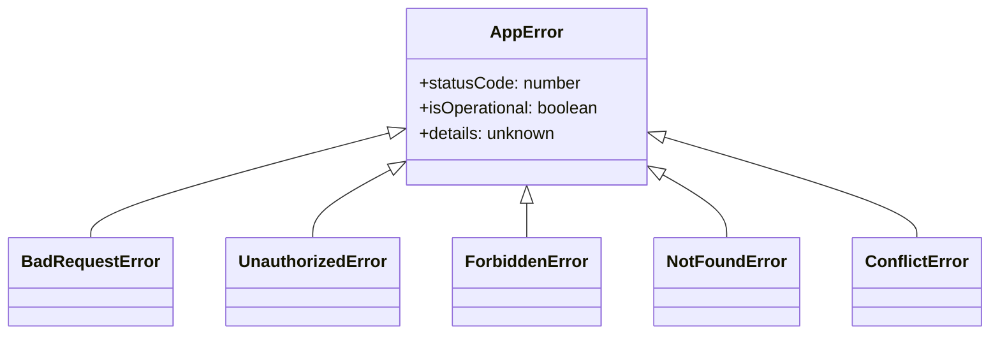
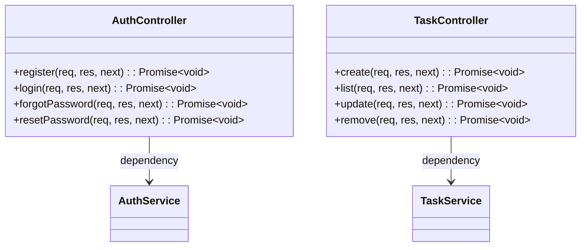
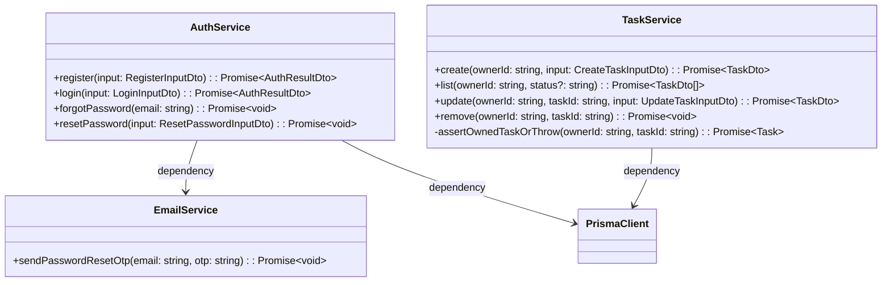
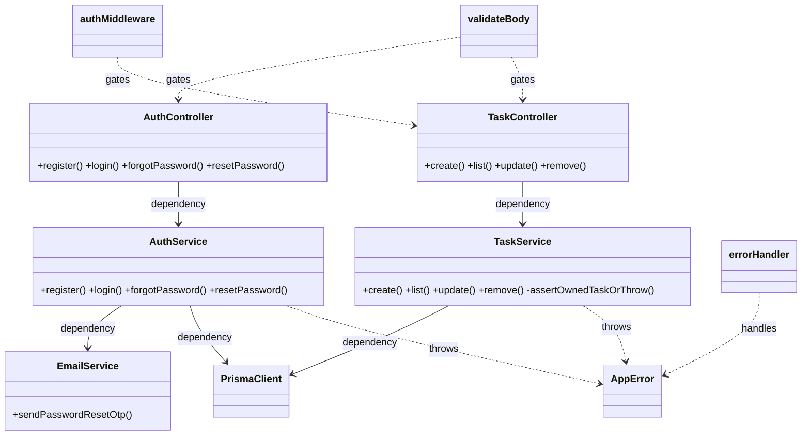
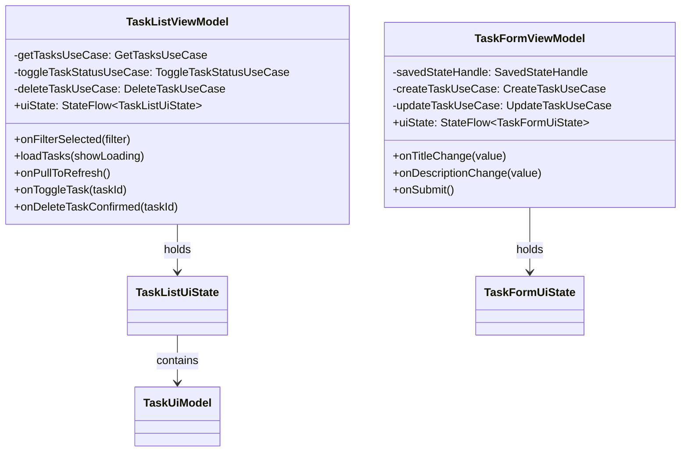
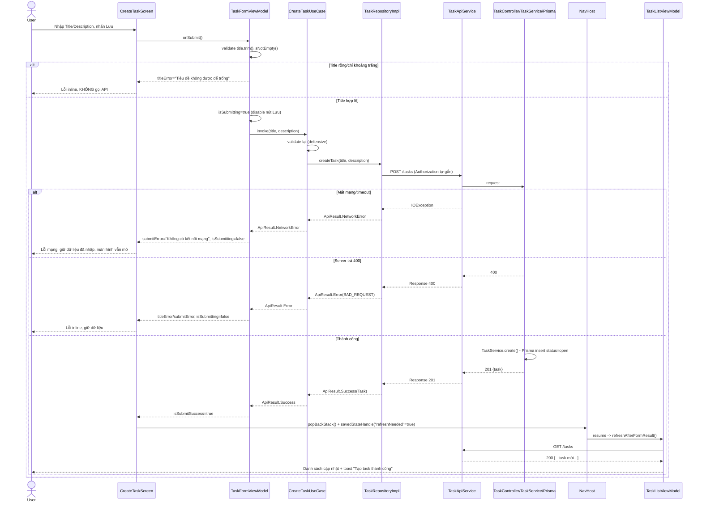
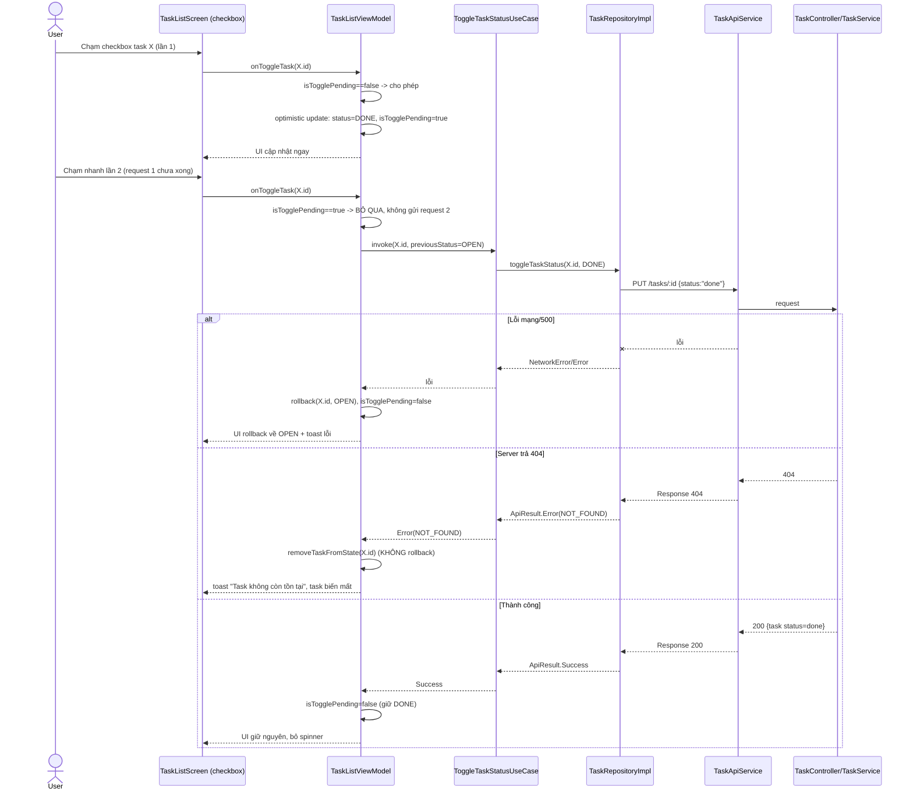

# Low-Level Design: Ứng dụng Android Quản lý Task/To-Do (CRUD) — Full-Stack

| | |
|---|---|
| **Dự án** | Full-Stack Assessment — Task 2: Task/To-Do CRUD Management |
| **Phiên bản LLD** | 1.0 |
| **Ngày tạo** | 2026-10-14 |
| **Nguồn căn cứ** | `docs/SRS_ToDo_Android.md` (v1.0), `docs/HLD_ToDo_Android.md` (v1.0) + 2 quyết định bổ sung đã chốt (register trả token trực tiếp; forgot-password luôn 200) |

## Mục 0. Phạm vi & căn cứ

**Phương án kiến trúc làm căn cứ (đã chốt ở HLD, KHÔNG đổi)**: Backend Node.js+Express+TypeScript, PostgreSQL+Prisma, layer Controller→Service→Prisma; Android Jetpack Compose, Clean Architecture 3 layer, Hilt DI, Retrofit+OkHttp, kotlinx.serialization, DataStore+security-crypto cho token, OkHttp Interceptor+SessionEventBus cho 401 toàn cục, online-only; Testing: Jest+Supertest (backend), JUnit4+MockK+Turbine+Compose UI Testing (Android).

**Bối cảnh code hiện tại**: Repo `D:\MyStartUp\ToDo` chỉ có file PDF + SRS + HLD, **chưa có code nào** — dự án greenfield, không có convention code cũ cần tuân theo.

---

# PHẦN A — BACKEND

## 1. Backend — Class/Module Design

### 1.1 Cấu trúc thư mục đề xuất

```
backend/
  src/
    app.ts                         # tạo Express app, đăng ký middleware/route
    server.ts                      # bootstrap http server, đọc PORT từ env
    config/
      env.ts                       # đọc & validate biến môi trường (DATABASE_URL, JWT_SECRET, SMTP_*)
      prisma.ts                    # export PrismaClient singleton
    routes/
      index.ts                     # gộp router auth + task
      auth.routes.ts
      task.routes.ts
    controllers/
      auth.controller.ts
      task.controller.ts
    services/
      auth.service.ts
      task.service.ts
      email.service.ts
    middlewares/
      auth.middleware.ts           # authMiddleware
      validate.middleware.ts       # validateBody / validateQuery (factory, dùng Zod)
      errorHandler.middleware.ts
      asyncHandler.ts              # wrap async controller -> forward exception vào errorHandler
    validators/
      auth.validators.ts           # Zod schema: register/login/forgotPassword/resetPassword
      task.validators.ts           # Zod schema: createTask/updateTask/listTaskQuery
    errors/
      AppError.ts
      BadRequestError.ts
      UnauthorizedError.ts
      ForbiddenError.ts
      NotFoundError.ts
      ConflictError.ts
    types/
      express.d.ts                 # augment Request.userId
      dto.ts                       # TaskDto, AuthResultDto, UserSafeDto... (nội bộ)
    utils/
      password.util.ts             # hashPassword/comparePassword (bcrypt)
      jwt.util.ts                  # signAccessToken/verifyAccessToken
      otp.util.ts                  # generateNumericOtp/hashOtp/compareOtp
    prisma/
      schema.prisma
      migrations/
  tests/
    auth.test.ts
    task.test.ts
  package.json
  tsconfig.json
  .env.example
```

### 1.2 Prisma schema (Ý TƯỞNG THIẾT KẾ — không phải migration thật)

```prisma
datasource db {
  provider = "postgresql"
  url      = env("DATABASE_URL")
}

generator client {
  provider = "prisma-client-js"
}

enum TaskStatus {
  open
  done
}

model User {
  id                   String     @id @default(uuid())
  email                String     @unique
  passwordHash         String
  resetOtpHash         String?
  resetOtpExpiresAt    DateTime?
  resetOtpAttemptCount Int        @default(0)
  createdAt            DateTime   @default(now())
  updatedAt            DateTime   @updatedAt
  tasks                Task[]
}

model Task {
  id          String     @id @default(uuid())
  ownerId     String
  owner       User       @relation(fields: [ownerId], references: [id], onDelete: Cascade)
  title       String
  description String?
  status      TaskStatus @default(open)
  createdAt   DateTime   @default(now())
  updatedAt   DateTime   @updatedAt

  @@index([ownerId])
  @@index([ownerId, status])
}
```

**Quyết định LLD — enum `TaskStatus` dùng giá trị `open`/`done` lowercase** (khác convention PascalCase phổ biến của Prisma) để khớp 1:1 với giá trị JSON "open"/"done" mà AC/SRS dùng xuyên suốt, tránh thêm một lớp mapping chữ hoa/thường giữa DB ↔ Service ↔ JSON response.

### 1.3 Quyết định: cấu trúc lưu OTP cho forgot-password

**Phương án chọn: thêm field vào bảng `User`** (`resetOtpHash`, `resetOtpExpiresAt`, `resetOtpAttemptCount`) — **không** tạo bảng `PasswordResetToken` riêng.

**Lý do:**
- Nghiệp vụ chỉ cần "1 OTP đang hiệu lực tại một thời điểm cho mỗi user" (yêu cầu OTP mới ghi đè OTP cũ) — quan hệ 1-1, không cần lưu lịch sử nhiều token/audit trail mà SRS không yêu cầu.
- Tránh JOIN thêm bảng ở mọi lần `reset-password` (vốn đã phải tìm `User` theo email trước).
- Giảm số migration/bảng cho scope demo/học thuật hiện tại (NFR-6..10 về scale chưa xác định — không có lý do kỹ thuật nào buộc phải tách bảng).
- Nhược điểm đã cân nhắc: nếu sau này cần audit lịch sử yêu cầu reset hoặc rate-limit theo IP/thiết bị phức tạp hơn, bảng riêng sẽ linh hoạt hơn — ghi nhận là điểm cần xem lại nếu NFR về bảo mật/audit được bổ sung sau.

**TTL và tham số đề xuất** (giả định, cần stakeholder xác nhận — SRS không có NFR cụ thể):
- `OTP_LENGTH = 6` (numeric).
- `OTP_TTL_MINUTES = 10`.
- `MAX_OTP_ATTEMPTS = 5` — vượt quá: tự xóa OTP hiện tại (buộc người dùng yêu cầu lại), tránh brute-force không giới hạn trên không gian 10^6 giá trị.
- OTP được **hash bằng bcrypt** trước khi lưu (không lưu plaintext trong DB), và bị **xóa ngay sau khi dùng thành công** (one-time use).

### 1.4 Error hierarchy & error handling tập trung



- `AppError(message: string, statusCode: number, details?: unknown)` — base class, `isOperational = true` để errorHandler phân biệt lỗi "đã biết trước, an toàn trả message cho client" với lỗi hệ thống bất ngờ.
- `BadRequestError` → 400 (validate fail, OTP sai/hết hạn, update task thiếu field).
- `UnauthorizedError` → 401 (JWT thiếu/sai/hết hạn, sai email/mật khẩu login).
- `ForbiddenError` → 403 (task tồn tại nhưng không thuộc user hiện tại).
- `NotFoundError` → 404 (task không tồn tại/đã bị xóa).
- `ConflictError` → 409 (email đã tồn tại khi register).

**`asyncHandler(fn): RequestHandler`** — bọc mọi controller method async, bắt promise rejection và gọi `next(err)` thay vì để unhandled rejection; áp dụng đồng nhất cho mọi route (vì Express 4 không tự forward lỗi async).

**`errorHandler(err, req, res, next): void`** (middleware cuối cùng trong chain):

```
# Pseudocode minh họa ý tưởng, không phải code cuối cùng
function errorHandler(err, req, res, next):
    if err instanceof AppError and err.isOperational:
        log.warn({ path: req.path, status: err.statusCode, message: err.message })
        return res.status(err.statusCode).json({ message: err.message, details: err.details })
    else:
        log.error({ path: req.path, error: err })        # log đầy đủ nội bộ, KHÔNG trả cho client
        if env.NODE_ENV == "production":
            return res.status(500).json({ message: "Đã có lỗi xảy ra, vui lòng thử lại sau" })
        else:
            return res.status(500).json({ message: err.message, stack: err.stack })  # chỉ dev
```

**Nguyên tắc log**: không bao giờ log `password`, `confirmPassword`, OTP plaintext, hay JWT token — log phải mask/loại bỏ các field này trước khi ghi (đáp ứng NFR-3/NFR-4 SRS).

### 1.5 Middlewares

| Middleware | Signature | Hành vi |
|---|---|---|
| `authMiddleware` | `(req, res, next): void` | Đọc header `Authorization: Bearer <token>`; thiếu/sai format → `next(new UnauthorizedError(...))`; verify qua `jwt.util.verifyAccessToken`; lỗi verify (hết hạn/sai signature) → `next(new UnauthorizedError(...))`; thành công → gắn `req.userId = payload.sub`, `next()`. |
| `validateBody(schema)` | `(req, res, next): void` (factory trả middleware) | `schema.safeParse(req.body)`; fail → `next(new BadRequestError("Dữ liệu không hợp lệ", issues))`; success → `req.body = result.data` (dữ liệu đã trim/coerce), `next()`. |
| `validateQuery(schema)` | tương tự `validateBody` nhưng áp cho `req.query` | Dùng cho `GET /tasks?status=`. |
| `errorHandler` | `(err, req, res, next): void` | Xem mục 1.4. |

### 1.6 `types/express.d.ts` (ý tưởng augmentation)

- Mở rộng kiểu `Request` của Express với field `userId?: string`, được `authMiddleware` gán trước khi vào Controller. Mọi Controller `/tasks/*` đọc `req.userId!` (non-null vì `authMiddleware` đã short-circuit nếu thiếu).

### 1.7 Controllers



| Method | Mô tả hành vi |
|---|---|
| `AuthController.register` | Gọi `authService.register(req.body)` → `res.status(201).json({ accessToken, user })`. |
| `AuthController.login` | Gọi `authService.login(req.body)` → `res.status(200).json({ accessToken, user })`. |
| `AuthController.forgotPassword` | Gọi `authService.forgotPassword(req.body.email)`. **Bất kể service làm gì bên trong (tìm thấy user hay không), controller LUÔN** `res.status(200).json({ message: "Nếu email tồn tại trong hệ thống, bạn sẽ nhận được hướng dẫn đặt lại mật khẩu" })` — không branch theo kết quả service. |
| `AuthController.resetPassword` | Gọi `authService.resetPassword(req.body)` → thành công `res.status(200).json({ message: "Đặt lại mật khẩu thành công" })`; lỗi (OTP sai/hết hạn) service đã `throw BadRequestError` → `asyncHandler` forward vào `errorHandler`. |
| `TaskController.create` | `taskService.create(req.userId!, req.body)` → `201`. |
| `TaskController.list` | `taskService.list(req.userId!, req.query.status)` → `200`. |
| `TaskController.update` | `taskService.update(req.userId!, req.params.id, req.body)` → `200`. |
| `TaskController.remove` | `taskService.remove(req.userId!, req.params.id)` → `204` (no body). |

### 1.8 Services



### 1.9 Pseudocode nghiệp vụ phức tạp

> Pseudocode minh họa ý tưởng, không phải code cuối cùng.

**Register:**
```
function register(email, password, confirmPassword):
    if confirmPassword != password:
        throw BadRequestError("Xác nhận mật khẩu không khớp")
    existingUser = prisma.user.findUnique({ email })
    if existingUser != null:
        throw ConflictError("Email đã được sử dụng")
    passwordHash = bcrypt.hash(password, SALT_ROUNDS=10)
    user = prisma.user.create({ email, passwordHash })
    accessToken = jwt.sign({ sub: user.id, email: user.email }, JWT_SECRET, { expiresIn: JWT_TTL })
    return { accessToken, user: toSafeUserDto(user) }
```

**Login:**
```
function login(email, password):
    user = prisma.user.findUnique({ email })
    if user == null:
        throw UnauthorizedError("Email hoặc mật khẩu không đúng")   # KHÔNG tiết lộ trường nào sai
    isMatch = bcrypt.compare(password, user.passwordHash)
    if not isMatch:
        throw UnauthorizedError("Email hoặc mật khẩu không đúng")
    accessToken = jwt.sign({ sub: user.id, email: user.email }, JWT_SECRET, { expiresIn: JWT_TTL })
    return { accessToken, user: toSafeUserDto(user) }
```

**Forgot-password (luôn trả 200 ở Controller, logic phân nhánh chỉ nằm trong Service):**
```
function forgotPassword(email):
    user = prisma.user.findUnique({ email })
    if user == null:
        return                                 # KHÔNG throw, KHÔNG làm gì thêm — tránh lộ user không tồn tại
    otp = generateNumericOtp(length=6)
    otpHash = bcrypt.hash(otp, SALT_ROUNDS=10)
    expiresAt = now() + OTP_TTL_MINUTES(10)
    prisma.user.update(user.id, {
        resetOtpHash: otpHash,
        resetOtpExpiresAt: expiresAt,
        resetOtpAttemptCount: 0
    })
    try:
        emailService.sendPasswordResetOtp(email, otp)
    catch emailError:
        log.error("Gửi OTP thất bại", emailError)   # CHỈ log, KHÔNG throw ra Controller
    return
```
**Lưu ý quan trọng**: lỗi gửi email bị **nuốt có chủ đích** (log nhưng không propagate) — đây KHÔNG phải catch rỗng vi phạm nguyên tắc chống im lặng lỗi vì có log; đây là quyết định bảo mật bắt buộc để response giữa "email tồn tại nhưng SMTP lỗi" và "email không tồn tại" **giống nhau 100%** từ phía client, tránh user-enumeration. Rủi ro còn lại: nếu SMTP lỗi, người dùng hợp lệ sẽ không nhận được OTP mà không biết — ghi nhận ở mục Giả định.

**Reset-password:**
```
function resetPassword(email, otp, newPassword):
    genericError = BadRequestError("Mã xác nhận không đúng hoặc đã hết hạn")
    user = prisma.user.findUnique({ email })
    if user == null: throw genericError
    if user.resetOtpHash == null or user.resetOtpExpiresAt < now(): throw genericError
    if user.resetOtpAttemptCount >= MAX_OTP_ATTEMPTS(5):
        prisma.user.update(user.id, { resetOtpHash: null, resetOtpExpiresAt: null, resetOtpAttemptCount: 0 })
        throw genericError
    otpMatches = bcrypt.compare(otp, user.resetOtpHash)
    if not otpMatches:
        prisma.user.update(user.id, { resetOtpAttemptCount: user.resetOtpAttemptCount + 1 })
        throw genericError
    newPasswordHash = bcrypt.hash(newPassword, SALT_ROUNDS=10)
    prisma.user.update(user.id, {
        passwordHash: newPasswordHash,
        resetOtpHash: null, resetOtpExpiresAt: null, resetOtpAttemptCount: 0   # invalidate OTP, one-time use
    })
    return
```

**Ownership check (Update/Toggle/Delete) — phân biệt rõ 404 vs 403:**
```
function assertOwnedTaskOrThrow(ownerId, taskId):
    task = prisma.task.findUnique({ id: taskId })
    if task == null:
        throw NotFoundError("Task không tồn tại")          # task thực sự không có trong DB
    if task.ownerId != ownerId:
        throw ForbiddenError("Bạn không có quyền thực hiện thao tác này")  # tồn tại nhưng không phải chủ
    return task

function update(ownerId, taskId, input):
    task = assertOwnedTaskOrThrow(ownerId, taskId)
    updated = prisma.task.update(taskId, {
        title: input.title ?? task.title,
        description: input.description ?? task.description,
        status: input.status ?? task.status
    })
    return toTaskDto(updated)

function remove(ownerId, taskId):
    task = assertOwnedTaskOrThrow(ownerId, taskId)
    prisma.task.delete(taskId)
```

### 1.10 Validators (Zod — ý nghĩa, không phải code thật)

| Schema | Field | Rule |
|---|---|---|
| `registerSchema` | `email` | string, format email |
| | `password` | string, min 8, phải có ≥1 chữ và ≥1 số |
| | `confirmPassword` | string, `.refine()` phải khớp `password` *(giả định — xem mục 10 Giả định)* |
| `loginSchema` | `email`, `password` | string, không rỗng (không enforce format ở login) |
| `forgotPasswordSchema` | `email` | string, format email |
| `resetPasswordSchema` | `email` | string, format email |
| | `otp` | string, đúng 6 ký tự số |
| | `newPassword` | như `password` ở register |
| | `confirmNewPassword` | `.refine()` khớp `newPassword` |
| `createTaskSchema` | `title` | string, `.trim()`, min 1 (reject rỗng/chỉ-khoảng-trắng) |
| | `description` | string, optional |
| `updateTaskSchema` | `title?`, `description?`, `status?` ('open'\|'done') | tất cả optional, `.refine()` phải có **ít nhất 1 field** được cung cấp |
| `listTaskQuerySchema` | `status?` | enum `'open' \| 'done' \| 'all'`, optional (absent = 'all') |

### 1.11 Bảng xử lý lỗi/exception (Backend)

| Method/luồng | Exception có thể ném | Tình huống | Nơi bắt/xử lý | Retry/Fallback |
|---|---|---|---|---|
| `authMiddleware` | `UnauthorizedError` | Thiếu header, token sai signature/hết hạn | `errorHandler` (qua `next(err)`) | Không retry (lỗi input/credential, fail-fast); client phải đăng nhập lại |
| `validateBody`/`validateQuery` | `BadRequestError` | Body/query không khớp schema | `errorHandler` | Không retry (lỗi input) |
| `AuthService.register` | `ConflictError` | Email đã tồn tại | `errorHandler` | Không retry |
| `AuthService.login` | `UnauthorizedError` | Sai email/mật khẩu | `errorHandler` | Không retry |
| `AuthService.forgotPassword` | (không ném ra ngoài) | Lỗi gửi email SMTP | **Service tự bắt, log, không propagate** | Không retry gửi email ở v1 (ghi nhận là giới hạn đã biết, xem mục 10) |
| `AuthService.resetPassword` | `BadRequestError` | OTP sai/hết hạn/vượt max attempt | `errorHandler` | Không retry — user phải yêu cầu OTP mới |
| `TaskService.assertOwnedTaskOrThrow` | `NotFoundError`, `ForbiddenError` | Task không tồn tại / không phải chủ | `errorHandler` | Không retry |
| `PrismaClient` (bất kỳ lỗi kết nối DB) | Lỗi không phải `AppError` (vd `PrismaClientKnownRequestError`, lỗi connection) | DB down/timeout | `errorHandler` nhánh `else` → log đầy đủ, trả `500` chung, **không lộ stack trace ở production** | Không có retry tự động trong scope này (ngoài phạm vi: connection pool/circuit breaker thuộc thiết kế hạ tầng) |

### 1.12 Gợi ý điểm cần test (Backend)

- Unit test `TaskService.update`/`remove` với 3 case: task không tồn tại (404), task thuộc user khác (403), task hợp lệ (200) — đúng Unit Test Scenario #2/#4 SRS mục 7.1.
- Unit test `AuthService.resetPassword`: OTP đúng, OTP sai, OTP hết hạn, vượt `MAX_OTP_ATTEMPTS` — mỗi case nên có test riêng vì nhiều nhánh rẽ.
- Integration test (Supertest) `POST /auth/forgot-password` với email tồn tại và không tồn tại → **phải assert response hoàn toàn giống nhau** (status 200, cùng body) — đây là test quan trọng nhất để đảm bảo không có user-enumeration leak.
- Integration test `GET /tasks?status=open` với dữ liệu mixed status — đúng Scenario #5 SRS.
- Edge case cần test riêng: `updateTaskSchema` refine "phải có ít nhất 1 field" — gửi body rỗng `{}` phải trả 400.
- Gợi ý dùng `test-writer` để viết test thật dựa trên các điểm trên.

## 2. Backend — Sơ đồ lớp tổng thể



---

# PHẦN B — ANDROID

## 3. Android — Cấu trúc package & Domain/Data layer

### 3.1 Cấu trúc package đề xuất (Gradle đơn-module)

**Quyết định LLD**: dùng **1 Gradle module duy nhất** (`app`) với package phân tách rõ theo layer, thay vì đa-module. Lý do: scope dự án (7 màn hình, CRUD đơn giản) không đủ lớn để cần build-time isolation của đa-module; ranh giới layer vẫn được giữ nghiêm qua convention import (domain không import `android.*`), đủ để đáp ứng yêu cầu testability của HLD. Có thể tách module sau nếu dự án scale lên.

```
app/src/main/java/com/example/todo/
  core/
    session/
      SessionEventBus.kt
      SessionEvent.kt                 # sealed class { object SessionExpired }
  domain/
    model/
      Task.kt
      TaskStatus.kt
      AuthSession.kt
      AuthUser.kt
    common/
      ApiResult.kt                    # sealed class ApiResult<T> { Success, Error, NetworkError }
      ApiErrorCode.kt
    repository/
      AuthRepository.kt
      TaskRepository.kt
    usecase/
      auth/
        RegisterUseCase.kt
        LoginUseCase.kt
        LogoutUseCase.kt
        ForgotPasswordUseCase.kt
        ResetPasswordUseCase.kt
      task/
        GetTasksUseCase.kt
        GetTaskByIdUseCase.kt
        CreateTaskUseCase.kt
        UpdateTaskUseCase.kt
        ToggleTaskStatusUseCase.kt
        DeleteTaskUseCase.kt
  data/
    remote/
      dto/
        auth/
          RegisterRequestDto.kt, LoginRequestDto.kt
          ForgotPasswordRequestDto.kt, ResetPasswordRequestDto.kt
          AuthResponseDto.kt, UserDto.kt
        task/
          TaskDto.kt, CreateTaskRequestDto.kt, UpdateTaskRequestDto.kt
      api/
        AuthApiService.kt
        TaskApiService.kt
      interceptor/
        AuthHeaderInterceptor.kt
        SessionExpiredInterceptor.kt
    local/
      TokenLocalDataSource.kt         # interface + impl (DataStore + security-crypto)
    mapper/
      TaskMapper.kt
      UserMapper.kt
    repository/
      AuthRepositoryImpl.kt
      TaskRepositoryImpl.kt
  presentation/
    auth/
      LoginScreen.kt, LoginViewModel.kt, LoginUiState.kt
      RegisterScreen.kt, RegisterViewModel.kt, RegisterUiState.kt
      ForgotPasswordScreen.kt, ForgotPasswordViewModel.kt, ForgotPasswordUiState.kt
      ResetPasswordScreen.kt, ResetPasswordViewModel.kt, ResetPasswordUiState.kt
    tasklist/
      TaskListScreen.kt, TaskListViewModel.kt, TaskListUiState.kt, TaskUiModel.kt
    taskform/
      CreateTaskScreen.kt, EditTaskScreen.kt
      TaskFormViewModel.kt, TaskFormUiState.kt
    navigation/
      Routes.kt, NavGraph.kt
      SessionObserverViewModel.kt     # collect SessionEventBus tại NavHost gốc
  di/
    NetworkModule.kt, DataStoreModule.kt, RepositoryModule.kt
```

### 3.2 Domain Entities

```kotlin
// Ý tưởng thiết kế, không phải code compile được
data class Task(
    val id: String,
    val title: String,
    val description: String?,
    val status: TaskStatus,
    val createdAt: Instant,
    val updatedAt: Instant
)
enum class TaskStatus { OPEN, DONE }

data class AuthSession(val accessToken: String, val user: AuthUser)
data class AuthUser(val id: String, val email: String)
```

### 3.3 `ApiResult` — Result type xuyên suốt Repository → UseCase → ViewModel

```kotlin
// domain/common/ApiResult.kt — Ý tưởng thiết kế
sealed class ApiResult<out T> {
    data class Success<out T>(val data: T) : ApiResult<T>()
    data class Error(val code: ApiErrorCode, val message: String?) : ApiResult<Nothing>()
    data object NetworkError : ApiResult<Nothing>()
}

enum class ApiErrorCode { BAD_REQUEST, UNAUTHORIZED, FORBIDDEN, NOT_FOUND, CONFLICT, SERVER_ERROR, UNKNOWN }
```

Đặt trong `domain/common` (Kotlin thuần, không phụ thuộc Android) để cả Domain lẫn Data đều dùng được (Data phụ thuộc Domain theo đúng hướng Clean Architecture, không ngược lại) — đây chính là cơ chế đảm bảo **exception không bao giờ bay tự do lên UI**: mọi lỗi (HTTP 4xx/5xx, `IOException` mất mạng, lỗi parse JSON) đều được Repository Impl chặn và chuyển thành một trong 3 nhánh của `ApiResult` trước khi trả lên UseCase/ViewModel.

### 3.4 Repository interfaces (Domain)

```kotlin
// Ý tưởng thiết kế
interface AuthRepository {
    suspend fun register(email: String, password: String, confirmPassword: String): ApiResult<AuthSession>
    suspend fun login(email: String, password: String): ApiResult<AuthSession>
    suspend fun logout()                                      // chỉ xóa token cục bộ, KHÔNG gọi API (không có /auth/logout)
    suspend fun forgotPassword(email: String): ApiResult<Unit>
    suspend fun resetPassword(email: String, otp: String, newPassword: String, confirmNewPassword: String): ApiResult<Unit>
    suspend fun hasStoredToken(): Boolean                     // kiểm tra nhanh có token lưu cục bộ hay không (dùng cho "giữ phiên")
}

interface TaskRepository {
    suspend fun getTasks(filter: TaskStatus? = null): ApiResult<List<Task>>
    suspend fun getTaskById(id: String): ApiResult<Task>   // dùng để load dữ liệu cho EditTaskScreen (thay SelectedTaskHolder)
    suspend fun createTask(title: String, description: String?): ApiResult<Task>
    suspend fun editTask(id: String, title: String, description: String?): ApiResult<Task>
    suspend fun toggleTaskStatus(id: String, newStatus: TaskStatus): ApiResult<Task>
    suspend fun deleteTask(id: String): ApiResult<Unit>
}
```

**Quyết định LLD**: tách `editTask` (sửa title/description) và `toggleTaskStatus` (đổi status) thành **2 method riêng** trên `TaskRepository` dù cả hai cùng gọi `PUT /tasks/:id` ở tầng HTTP — tránh dùng tham số `null` làm "sentinel nghĩa là không đổi" (dễ nhầm lẫn với "đổi thành null/rỗng"), giúp mỗi UseCase có một hành vi rõ ràng, dễ test độc lập.

### 3.5 Data layer — DTO, ApiService, Mapper, Repository Impl

> **DTO/JSON field dưới đây là GIẢ ĐỊNH mức khái niệm** để thiết kế Retrofit interface nội bộ — **không phải API contract chính thức** (việc chốt field name/format thật thuộc `api-designer`, cần làm trước khi code thật).

```kotlin
// data/remote/dto — Ý tưởng thiết kế
@Serializable data class RegisterRequestDto(val email: String, val password: String, val confirmPassword: String)
@Serializable data class LoginRequestDto(val email: String, val password: String)
@Serializable data class ForgotPasswordRequestDto(val email: String)
@Serializable data class ResetPasswordRequestDto(val email: String, val otp: String, val newPassword: String, val confirmNewPassword: String)
@Serializable data class AuthResponseDto(val accessToken: String, val user: UserDto)
@Serializable data class UserDto(val id: String, val email: String)

@Serializable data class TaskDto(
    val id: String, val title: String, val description: String?,
    val status: String,          // "open" | "done" — khớp Prisma enum
    val createdAt: String, val updatedAt: String   // ISO-8601 string
)
@Serializable data class CreateTaskRequestDto(val title: String, val description: String?)
@Serializable data class UpdateTaskRequestDto(val title: String? = null, val description: String? = null, val status: String? = null)
```

```kotlin
// data/remote/api — Ý tưởng thiết kế
interface AuthApiService {
    @POST("auth/register") suspend fun register(@Body body: RegisterRequestDto): Response<AuthResponseDto>
    @POST("auth/login") suspend fun login(@Body body: LoginRequestDto): Response<AuthResponseDto>
    @POST("auth/forgot-password") suspend fun forgotPassword(@Body body: ForgotPasswordRequestDto): Response<Unit>
    @POST("auth/reset-password") suspend fun resetPassword(@Body body: ResetPasswordRequestDto): Response<Unit>
}

interface TaskApiService {
    @GET("tasks") suspend fun getTasks(@Query("status") status: String?): Response<List<TaskDto>>
    @GET("tasks/{id}") suspend fun getTaskById(@Path("id") id: String): Response<TaskDto>
    @POST("tasks") suspend fun createTask(@Body body: CreateTaskRequestDto): Response<TaskDto>
    @PUT("tasks/{id}") suspend fun updateTask(@Path("id") id: String, @Body body: UpdateTaskRequestDto): Response<TaskDto>
    @DELETE("tasks/{id}") suspend fun deleteTask(@Path("id") id: String): Response<Unit>
}
```

**Mapper** (`TaskMapper`): `fun TaskDto.toDomain(): Task` (parse `status` string → enum, parse ISO string → `Instant`); `fun Task.toCreateRequestDto(): CreateTaskRequestDto`; tương tự `UserMapper` cho `UserDto ↔ AuthUser`.

**`TaskRepositoryImpl`/`AuthRepositoryImpl`**: mỗi method implement bằng cách gọi `ApiService` tương ứng, bọc trong hàm dùng chung `safeApiCall` (pseudocode dưới), map response thành công qua Mapper, map lỗi thành `ApiResult.Error`/`ApiResult.NetworkError`. `AuthRepositoryImpl` thêm bước gọi `TokenLocalDataSource.saveToken()` sau khi `register`/`login` thành công, và `TokenLocalDataSource.clearToken()` trong `logout()`.

### 3.6 Pseudocode: `safeApiCall` — chặn exception bay lên UI

> Pseudocode minh họa ý tưởng, không phải code cuối cùng.

```
suspend fun <T> safeApiCall(block: suspend () -> Response<T>): ApiResult<T> {
    try {
        response = block()
        if response.isSuccessful:
            return ApiResult.Success(response.body())
        else:
            code = mapHttpStatusToApiErrorCode(response.code())   # 400->BAD_REQUEST, 401->UNAUTHORIZED,
                                                                    # 403->FORBIDDEN, 404->NOT_FOUND, 409->CONFLICT, 5xx->SERVER_ERROR
            message = parseErrorBody(response.errorBody())
            return ApiResult.Error(code, message)
    catch (e: IOException):           # mất mạng, timeout
        return ApiResult.NetworkError
    catch (e: Exception):             # lỗi parse JSON / lỗi không lường trước
        return ApiResult.Error(ApiErrorCode.UNKNOWN, e.message)
}
```
**Lưu ý**: dù `401` đã được `SessionExpiredInterceptor` xử lý toàn cục (xóa token + emit `SessionEventBus`) *trước khi* response này tới `safeApiCall`, hàm này vẫn phải trả `ApiResult.Error(UNAUTHORIZED,...)` bình thường — để coroutine đang gọi (ở ViewModel) kết thúc gọn gàng (tắt loading) thay vì bị treo; việc điều hướng về Login được xử lý riêng qua `SessionEventBus`, không phụ thuộc vào nhánh này.

### 3.7 OkHttp Interceptor — 401 toàn cục

```kotlin
// Ý tưởng thiết kế
class AuthHeaderInterceptor(private val tokenLocalDataSource: TokenLocalDataSource) : Interceptor {
    override fun intercept(chain: Interceptor.Chain): okhttp3.Response
    // chỉ gắn header Authorization cho request có path bắt đầu "/tasks" (không áp dụng /auth/*)
}

class SessionExpiredInterceptor(
    private val tokenLocalDataSource: TokenLocalDataSource,
    private val sessionEventBus: SessionEventBus,
    private val appScope: CoroutineScope          // CoroutineScope(SupervisorJob() + Dispatchers.IO), sống cùng Application
) : Interceptor {
    override fun intercept(chain: Interceptor.Chain): okhttp3.Response
}
```

```
# Pseudocode minh họa ý tưởng, không phải code cuối cùng
function AuthHeaderInterceptor.intercept(chain):
    request = chain.request()
    if request.url.path startsWith "/tasks":
        token = tokenLocalDataSource.getTokenBlocking()   # đọc đồng bộ, chạy trên OkHttp dispatcher thread
        if token != null:
            request = request.newBuilder().addHeader("Authorization", "Bearer $token").build()
    return chain.proceed(request)

function SessionExpiredInterceptor.intercept(chain):
    response = chain.proceed(chain.request())
    if response.code == 401:
        appScope.launch {                                  # intercept() KHÔNG phải suspend fun -> phải launch coroutine riêng
            tokenLocalDataSource.clearToken()
            sessionEventBus.emit(SessionEvent.SessionExpired)
        }
    return response
```

**Điểm kỹ thuật quan trọng**: `Interceptor.intercept()` chạy trên thread dispatcher của OkHttp, **không phải** suspend function — mọi lời gọi `suspend` (`clearToken()`, `emit()`) phải được bọc trong `appScope.launch{}` riêng, không thể gọi trực tiếp.

**`SessionEventBus`**:
```kotlin
// core/session — Ý tưởng thiết kế
class SessionEventBus {
    private val _events = MutableSharedFlow<SessionEvent>(replay = 0, extraBufferCapacity = 1)
    val events: SharedFlow<SessionEvent> = _events.asSharedFlow()
    suspend fun emit(event: SessionEvent)
}
sealed class SessionEvent { data object SessionExpired : SessionEvent() }
```
`replay = 0` để **không** phát lại sự kiện cũ cho observer mới subscribe sau (tránh re-trigger logout khi quay lại Login lần sau); `extraBufferCapacity = 1` để không mất event nếu emit xảy ra đúng lúc observer tạm gián đoạn collect (ví dụ do recomposition).

## 4. Android — Presentation layer

### 4.1 UseCases (10 cái theo HLD)

| UseCase | Signature | Validate trước khi gọi Repository |
|---|---|---|
| `RegisterUseCase` | `suspend operator fun invoke(email, password, confirmPassword): ApiResult<AuthSession>` | email format, password rule, confirm khớp — invalid → `ApiResult.Error(BAD_REQUEST,...)` ngay, KHÔNG gọi network |
| `LoginUseCase` | `suspend operator fun invoke(email, password): ApiResult<AuthSession>` | chỉ check non-empty |
| `LogoutUseCase` | `suspend operator fun invoke()` | không có — luôn thành công (chỉ xóa token cục bộ) |
| `ForgotPasswordUseCase` | `suspend operator fun invoke(email): ApiResult<Unit>` | email format |
| `ResetPasswordUseCase` | `suspend operator fun invoke(email, otp, newPassword, confirmNewPassword): ApiResult<Unit>` | otp non-empty, password rule, confirm khớp |
| `GetTasksUseCase` | `suspend operator fun invoke(filter: TaskFilter): ApiResult<List<Task>>` | map `TaskFilter.ALL → null` khi gọi repository |
| `CreateTaskUseCase` | `suspend operator fun invoke(title, description): ApiResult<Task>` | `title.trim().isNotEmpty()` — defensive, dù ViewModel đã validate |
| `UpdateTaskUseCase` | `suspend operator fun invoke(id, title, description): ApiResult<Task>` | `title.trim().isNotEmpty()` |
| `ToggleTaskStatusUseCase` | `suspend operator fun invoke(id, currentStatus): ApiResult<Task>` | tự tính `newStatus = opposite(currentStatus)`, gọi `repository.toggleTaskStatus` |
| `DeleteTaskUseCase` | `suspend operator fun invoke(id): ApiResult<Unit>` | không cần |

**Quyết định LLD về vị trí validate**: validate định dạng/non-empty được làm **2 lần** — (1) ở ViewModel để hiển thị lỗi inline *đồng bộ, tức thời* (đáp ứng AC "KHÔNG gọi API" khi invalid, không cần đợi coroutine); (2) ở UseCase một lần nữa mang tính **defensive** (bảo vệ invariant nghiệp vụ bất kể ViewModel nào gọi, tránh lỗi nếu sau này có thêm entry point khác quên validate). Đây không phải trùng lặp vô ích mà là ranh giới rõ giữa "UX phản hồi nhanh" (Presentation) và "bảo vệ invariant nghiệp vụ" (Domain).

### 4.2 ViewModel & UI State

**Quyết định LLD**: tách HLD's "AuthViewModel" (tên gộp) thành **4 ViewModel riêng** — `LoginViewModel`, `RegisterViewModel`, `ForgotPasswordViewModel`, `ResetPasswordViewModel` — mỗi màn hình một ViewModel qua `hiltViewModel()` theo route. Lý do: tránh một class ViewModel khổng lồ quản lý 4 state không liên quan, giữ single-responsibility, dễ test độc lập bằng MockK/Turbine (đúng tinh thần HLD, không mâu thuẫn ranh giới layer — chỉ cụ thể hóa số lượng class trong Presentation).

```kotlin
// Ý tưởng thiết kế — các UiState

data class LoginUiState(
    val email: String = "", val password: String = "",
    val emailError: String? = null, val passwordError: String? = null,
    val isSubmitting: Boolean = false, val generalError: String? = null,
    val loginSuccess: Boolean = false
)

data class RegisterUiState(
    val email: String = "", val password: String = "", val confirmPassword: String = "",
    val emailError: String? = null, val passwordError: String? = null, val confirmPasswordError: String? = null,
    val isSubmitting: Boolean = false, val generalError: String? = null,
    val registerSuccess: Boolean = false
)

data class ForgotPasswordUiState(
    val email: String = "", val emailError: String? = null,
    val isSubmitting: Boolean = false, val generalError: String? = null,
    val requestSent: Boolean = false     // true CHỈ khi backend thực sự phản hồi 200 (không phải network error)
)

data class ResetPasswordUiState(
    val email: String,                   // nhận từ nav arg (ForgotPasswordScreen truyền sang)
    val otp: String = "", val newPassword: String = "", val confirmNewPassword: String = "",
    val otpError: String? = null, val newPasswordError: String? = null, val confirmNewPasswordError: String? = null,
    val isSubmitting: Boolean = false, val generalError: String? = null,
    val resetSuccess: Boolean = false
)

data class TaskListUiState(
    val isLoading: Boolean = false,
    val isRefreshing: Boolean = false,
    val tasks: List<TaskUiModel> = emptyList(),
    val filter: TaskFilter = TaskFilter.ALL,
    val error: UiError? = null,
    val emptyStateType: EmptyStateType? = null,   // null nếu đang có task hiển thị
    val hasAnyTaskOverall: Boolean = false         // internal — dùng để tính emptyStateType, xem mục 4.4
)
enum class TaskFilter { ALL, OPEN, DONE }
enum class EmptyStateType { NO_TASKS_AT_ALL, NO_TASKS_MATCH_FILTER }
data class TaskUiModel(
    val id: String, val title: String,
    val descriptionPreview: String?,          // đã truncate 1 dòng ở Mapper tầng Presentation
    val status: TaskStatus,
    val isTogglePending: Boolean = false      // per-item loading flag — chống double-tap (mục 4.4)
)
data class UiError(val message: String, val isNetworkError: Boolean = false)

data class TaskFormUiState(
    val taskId: String? = null,               // null = Create, có giá trị = Edit
    val title: String = "", val description: String = "",
    val titleError: String? = null,
    val isSubmitting: Boolean = false,
    val submitError: UiError? = null,
    val taskDeletedRemotely: Boolean = false,  // true khi Edit gặp 404 (xem mục 4.4)
    val isSubmitSuccess: Boolean = false
)
```



### 4.3 Entity Domain vs DTO Data — mapping

| Khía cạnh | `Task` (Domain) | `TaskDto` (Data) |
|---|---|---|
| `status` | `TaskStatus` enum (`OPEN`/`DONE`) | `String` thô từ JSON (`"open"`/`"done"`) |
| `createdAt`/`updatedAt` | `kotlin.time.Instant` (hoặc `java.time.Instant`) | `String` ISO-8601 thô |
| Mục đích | Dùng trong UseCase/ViewModel, không phụ thuộc format JSON | Chỉ dùng trong Data layer, phản ánh đúng wire format |
| Mapping | `TaskMapper.toDomain(dto): Task` parse string→enum, string→Instant; `Task.toRequestDto()` ngược lại khi cần gửi lên server | |

Việc tách riêng tránh Domain/Presentation phải biết định dạng JSON cụ thể (nếu backend đổi format ngày giờ, chỉ `TaskMapper` cần sửa).

### 4.4 Pseudocode cho các cơ chế đặc thù mobile

> Pseudocode minh họa ý tưởng, không phải code cuối cùng.

**(a) Double-tap protection + rollback khi toggle:**
```
fun onToggleTask(taskId):
    targetTask = uiState.value.tasks.find { it.id == taskId } ?: return
    if targetTask.isTogglePending: return     # CHẶN double-tap: request trước chưa xong, bỏ qua tap mới
                                               # (check này chạy đồng bộ trên Main thread TRƯỚC điểm suspend đầu tiên,
                                               #  nên 2 tap liên tiếp luôn được xử lý tuần tự, không race)
    previousStatus = targetTask.status
    optimisticStatus = opposite(previousStatus)

    updateState { it.copy(tasks = it.tasks.map { t ->
        if t.id == taskId: t.copy(status = optimisticStatus, isTogglePending = true) else t
    }) }                                        # optimistic update + đánh dấu pending — ĐÚNG lúc, trước khi launch coroutine

    viewModelScope.launch {
        result = toggleTaskStatusUseCase(taskId, previousStatus)
        when (result):
            Success -> updateState { it.copy(tasks = it.tasks.map { t ->
                           if t.id == taskId: t.copy(isTogglePending = false) else t }) }
                       reapplyFilterIfNeeded()    # nếu đang lọc Open/Done, task không còn thỏa -> ẩn khỏi list hiển thị
            Error(NOT_FOUND) -> showToast("Task không còn tồn tại"); removeTaskFromState(taskId)   # loại hẳn, KHÔNG rollback status
            Error(FORBIDDEN) -> showToast("Bạn không có quyền thực hiện thao tác này"); rollback(taskId, previousStatus)
            Error(_) | NetworkError -> showToast("Có lỗi xảy ra, vui lòng thử lại"); rollback(taskId, previousStatus)

fun rollback(taskId, previousStatus):
    updateState { it.copy(tasks = it.tasks.map { t ->
        if t.id == taskId: t.copy(status = previousStatus, isTogglePending = false) else t
    }) }
```

**(b) Giữ dữ liệu form khi xoay màn hình**

**Quyết định LLD: dùng `ViewModel` + `SavedStateHandle`** (không dùng `rememberSaveable` ở Composable). Lý do:
- `ViewModel` tự sống sót qua rotation (configuration change) mặc định — chỉ cần state nằm trong `StateFlow` của ViewModel (không phải `remember{}` cục bộ trong Composable) là đã đáp ứng AC "xoay màn hình không mất dữ liệu".
- `SavedStateHandle` cho thêm một lớp bảo vệ mạnh hơn: sống sót qua **process death** (OS kill app khi background, mạnh hơn yêu cầu tối thiểu của AC nhưng chi phí gần như không đáng kể).
- Giữ state trong ViewModel (không phải Composable) nhất quán với Clean Architecture — Presentation state phải test được bằng MockK/Turbine không cần Compose UI Test, đúng chiến lược testing đã chốt ở HLD.

```
class TaskFormViewModel(savedStateHandle: SavedStateHandle, ...) {
    private val _uiState = MutableStateFlow(
        TaskFormUiState(
            taskId = savedStateHandle["taskId"],
            title = savedStateHandle["title"] ?: "",
            description = savedStateHandle["description"] ?: ""
        )
    )
    val uiState: StateFlow<TaskFormUiState> = _uiState.asStateFlow()

    fun onTitleChange(value):
        savedStateHandle["title"] = value          # ghi đồng thời vào SavedStateHandle
        updateState { it.copy(title = value, titleError = null) }

    fun onDescriptionChange(value):
        savedStateHandle["description"] = value
        updateState { it.copy(description = value) }
}
```

**(c) OkHttp Interceptor phát hiện 401 toàn cục → điều hướng Login** (đã mô tả chi tiết ở mục 3.7). Phần điều hướng tại Presentation:

```kotlin
class SessionObserverViewModel(private val sessionEventBus: SessionEventBus) : ViewModel() {
    val sessionEvents: SharedFlow<SessionEvent> = sessionEventBus.events   // pass-through, để test được qua Turbine
}
```
```
# Tại NavHost gốc (Composable) — Ý tưởng thiết kế
LaunchedEffect(Unit) {
    sessionObserverViewModel.sessionEvents.collect { event ->
        when (event) {
            SessionExpired -> {
                showSnackbar("Phiên đăng nhập đã hết hạn, vui lòng đăng nhập lại")
                # Nếu đang ở CreateTask/EditTask với dữ liệu chưa lưu -> hiển thị thêm cảnh báo mất dữ liệu (FR-04)
                navController.navigate(Routes.Login) {
                    popUpTo(0) { inclusive = true }   # xóa toàn bộ backstack -> Back không quay lại được
                    launchSingleTop = true
                }
            }
        }
    }
}
```

**(d) Xử lý 404 khi sửa/toggle/xóa task đã bị xóa ở thiết bị khác**

- Toggle: xem (a) — nhánh `Error(NOT_FOUND)` loại bỏ task khỏi `tasks` list ngay, không rollback status.
- Delete: tương tự — `onDeleteTaskConfirmed` nhận `Error(NOT_FOUND)` → coi như đã đạt mục đích (task không còn tồn tại), vẫn xóa khỏi UI, hiển thị "Task này đã được xóa trước đó" (không phải lỗi chung).
- Edit (trong `TaskFormViewModel.onSubmit`): nhận `Error(NOT_FOUND)` → set `taskDeletedRemotely = true`, hiển thị "Task này không còn tồn tại" → `EditTaskScreen` điều hướng quay lại `TaskListScreen` và set `savedStateHandle["refreshNeeded"] = true` trên `previousBackStackEntry` → `TaskListViewModel` tự `loadTasks()` lại.

**(e) Pull-to-refresh giữ nguyên filter:**
```
fun onPullToRefresh():
    currentFilter = uiState.value.filter
    updateState { it.copy(isRefreshing = true) }
    viewModelScope.launch {
        result = getTasksUseCase(currentFilter)
        when (result):
            Success -> updateState { it.copy(
                           isRefreshing = false, error = null,
                           tasks = mapToUiModel(result.data),
                           hasAnyTaskOverall = computeHasAnyTaskOverall(it, currentFilter, result.data),
                           emptyStateType = computeEmptyState(result.data, currentFilter, ...)) }
            Error(_) | NetworkError -> updateState { it.copy(isRefreshing = false, error = UiError(...)) }
                        # KHÔNG xóa `tasks` cũ — danh sách cũ giữ nguyên theo đúng AC FR-08
```

**(f) Empty-state phân biệt "chưa có task nào" vs "lọc không có kết quả":**

**Giả định LLD**: filter mặc định khi mở `TaskListScreen` lần đầu luôn là `ALL` — nhờ vậy lần load `ALL` đầu tiên luôn cho biết chắc chắn tổng thể có task hay không, trước khi người dùng có thể chọn `Open`/`Done`.

```
fun computeHasAnyTaskOverall(oldState, filter, newTasks):
    if filter == ALL:
        return newTasks.isNotEmpty()                 # ALL là nguồn chân lý tuyệt đối
    else:
        return oldState.hasAnyTaskOverall or newTasks.isNotEmpty()  # không hạ cờ nếu đã từng biết có task

fun computeEmptyState(tasksForCurrentFilter, filter, hasAnyTaskOverall):
    if tasksForCurrentFilter.isNotEmpty(): return null
    if filter == ALL: return NO_TASKS_AT_ALL
    return if hasAnyTaskOverall: NO_TASKS_MATCH_FILTER else NO_TASKS_AT_ALL
```

## 5. Android — Navigation Graph

| Route | Tham số | Ghi chú |
|---|---|---|
| `login` | — | Start destination. Khi ViewModel phát hiện `hasStoredToken() == true` lúc init → tự `navigate(TaskList) { popUpTo(Login){inclusive=true} }` ngay — nếu token thực đã hết hạn, lần gọi `GET /tasks` đầu tiên sẽ trả 401 và tự động bật lại cơ chế mục 4.4(c). |
| `register` | — | |
| `forgot_password` | — | |
| `reset_password/{email}` | `email: String` (required) | Nhận từ `ForgotPasswordScreen` sau khi backend trả 200. |
| `task_list` | — | "Home" sau khi đăng nhập. |
| `create_task` | — | |
| `edit_task/{taskId}` | `taskId: String` (required) | **(Cập nhật sau API Contract v1.0)** `TaskFormViewModel` gọi `GetTaskByIdUseCase(taskId)` → `GET /tasks/:id` để tự fetch dữ liệu task khi khởi tạo màn hình, KHÔNG còn phụ thuộc vào dữ liệu truyền từ màn hình trước. Thay thế hoàn toàn giải pháp `SelectedTaskHolder` in-memory đã đề xuất ban đầu (xem mục 10.3 — rủi ro process death nay đã được loại bỏ nhờ bổ sung endpoint `GET /tasks/:id` trong `docs/API_Contract_ToDo_Android.md`). |

**popUpTo khi logout/session-expired**: `navController.navigate(Routes.Login) { popUpTo(0) { inclusive = true }; launchSingleTop = true }` — áp dụng đồng nhất cho cả FR-03 (Logout) và FR-04 (401 toàn cục) — xóa toàn bộ backstack bất kể đang ở màn hình nào.

**Luồng tải dữ liệu `EditTaskScreen`** (thay thế `SelectedTaskHolder`):
```
# Pseudocode minh họa ý tưởng
class TaskFormViewModel(savedStateHandle: SavedStateHandle, getTaskByIdUseCase: GetTaskByIdUseCase, ...) {
    init {
        taskId = savedStateHandle["taskId"]
        if taskId != null and uiState.value.title.isEmpty():   # chỉ fetch nếu chưa có data (tránh fetch lại sau rotation)
            updateState { it.copy(isLoading = true) }
            viewModelScope.launch {
                result = getTaskByIdUseCase(taskId)
                when (result):
                    Success -> updateState { it.copy(isLoading = false, title = result.data.title, description = result.data.description ?: "") }
                    Error(NOT_FOUND) -> updateState { it.copy(isLoading = false, taskDeletedRemotely = true) }
                    Error(_) | NetworkError -> updateState { it.copy(isLoading = false, submitError = UiError("Không thể tải dữ liệu task")) }
            }
    }
}
```
`EditTaskScreen` hiển thị loading state trong lúc fetch; nếu `taskDeletedRemotely=true` hoặc lỗi mạng, hiển thị thông báo + cho phép quay lại danh sách (không còn tình huống "mất dữ liệu do process death" như thiết kế cũ).

## 6. Sequence Diagrams

### 6.1 Đăng ký → nhận token → vào TaskList

```mermaid
sequenceDiagram
    actor U as User
    participant RS as RegisterScreen
    participant RVM as RegisterViewModel
    participant RUC as RegisterUseCase
    participant AR as AuthRepositoryImpl
    participant AAPI as AuthApiService
    participant BE as Backend (Controller to Service to Prisma)
    participant DB as PostgreSQL
    participant TLD as TokenLocalDataSource
    participant NAV as NavHost
    participant TLVM as TaskListViewModel

    U->>RS: Nhập email/password/confirmPassword, nhấn Đăng ký
    RS->>RVM: onSubmit()
    RVM->>RVM: validate inline (format, rule, confirm match)
    alt Validate client thất bại
        RVM-->>RS: emailError/passwordError/confirmPasswordError
        RS-->>U: Lỗi inline, KHÔNG gọi API
    else Validate OK
        RVM->>RVM: isSubmitting = true
        RVM->>RUC: invoke(email, password, confirmPassword)
        RUC->>AR: register(...)
        AR->>AAPI: POST /auth/register
        AAPI->>BE: request
        BE->>DB: findUnique(email)
        alt Email đã tồn tại
            DB-->>BE: User found
            BE-->>AAPI: 409
            AAPI-->>AR: Response 409
            AR-->>RUC: ApiResult.Error(CONFLICT)
            RUC-->>RVM: ApiResult.Error
            RVM-->>RS: generalError="Email đã được sử dụng", isSubmitting=false
            RS-->>U: Hiển thị lỗi, giữ dữ liệu
        else Email chưa tồn tại
            DB-->>BE: null
            BE->>BE: bcrypt.hash(password); jwt.sign(...)
            BE->>DB: insert User
            BE-->>AAPI: 201 {accessToken, user}
            AAPI-->>AR: Response 201
            AR->>TLD: saveToken(accessToken)
            AR-->>RUC: ApiResult.Success(AuthSession)
            RUC-->>RVM: ApiResult.Success
            RVM-->>RS: registerSuccess=true, isSubmitting=false
            RS->>NAV: navigate(TaskList) popUpTo(Login){inclusive=true}
            NAV->>TLVM: init -> loadTasks()
            TLVM->>AAPI: GET /tasks (Authorization gắn tự động bởi Interceptor)
            AAPI-->>TLVM: 200 []
            TLVM-->>U: TaskListScreen, empty-state "Bạn chưa có task nào" + toast chào mừng
        end
    end
```

### 6.2 Quên mật khẩu → OTP → đặt lại mật khẩu thành công

```mermaid
sequenceDiagram
    actor U as User
    participant FPS as ForgotPasswordScreen/VM
    participant RPS as ResetPasswordScreen/VM
    participant AR as AuthRepositoryImpl
    participant AAPI as AuthApiService
    participant BE as AuthController/AuthService
    participant DB as PostgreSQL (User)
    participant MAIL as EmailService/SMTP

    U->>FPS: Nhập email, nhấn Gửi
    FPS->>FPS: validate format email (client)
    FPS->>AR: forgotPassword(email)
    AR->>AAPI: POST /auth/forgot-password
    AAPI->>BE: request
    BE->>DB: findUnique(email)
    alt Email tồn tại
        DB-->>BE: User found
        BE->>BE: generateOtp(); hashOtp(); set resetOtp* (TTL 10')
        BE->>DB: update User
        BE->>MAIL: sendPasswordResetOtp(email, otp)
        MAIL-->>BE: (async, lỗi chỉ log, KHÔNG throw)
    else Email không tồn tại
        DB-->>BE: null
        Note over BE: Không làm gì thêm
    end
    BE-->>AAPI: 200 {"message":"Nếu email tồn tại..."}
    AAPI-->>FPS: 200 (LUÔN 200 dù email tồn tại hay không)
    FPS-->>U: Thông báo trung lập, điều hướng ResetPasswordScreen(email)
    U->>RPS: Nhập OTP + mật khẩu mới + xác nhận, nhấn Xác nhận
    RPS->>RPS: validate inline (non-empty, rule, confirm match)
    RPS->>AR: resetPassword(email, otp, newPassword, confirmNewPassword)
    AR->>AAPI: POST /auth/reset-password
    AAPI->>BE: request
    BE->>DB: findUnique(email)
    alt User null / OTP null hoặc hết hạn / vượt max attempt
        BE-->>AAPI: 400 "Mã xác nhận không đúng hoặc đã hết hạn"
        AAPI-->>RPS: ApiResult.Error(BAD_REQUEST)
        RPS-->>U: Lỗi inline trên ô OTP
    else OTP hash không khớp
        BE->>DB: increment resetOtpAttemptCount
        BE-->>AAPI: 400 (cùng message)
        AAPI-->>RPS: ApiResult.Error(BAD_REQUEST)
        RPS-->>U: Lỗi inline trên ô OTP
    else OTP khớp và còn hạn
        BE->>BE: bcrypt.hash(newPassword)
        BE->>DB: update passwordHash; clear resetOtp*
        BE-->>AAPI: 200 "Đặt lại mật khẩu thành công"
        AAPI-->>RPS: ApiResult.Success
        RPS-->>U: Thông báo thành công, điều hướng LoginScreen
    end
```

### 6.3 Tạo Task (happy path + nhánh lỗi validate/network)



### 6.4 Toggle trạng thái task — double-tap protection + rollback



## 7. Bảo mật ở cấp class/module

### 7.1 Backend
- Điểm validate input đầu tiên: `validateBody`/`validateQuery` middleware (Zod) — chạy trước mọi Controller.
- Điểm kiểm tra quyền: `authMiddleware` (JWT hợp lệ mới vào được `/tasks/*`) và `TaskService.assertOwnedTaskOrThrow` (kiểm tra `ownerId` trước Update/Delete).
- Secret/token: `JWT_SECRET` đọc từ biến môi trường qua `config/env.ts`, không hardcode, không log, không trả về trong bất kỳ response/error message nào.
- Password/OTP: luôn hash (bcrypt) trước khi lưu DB; không log plaintext ở bất kỳ tầng nào.
- `/auth/forgot-password` luôn 200 bất kể email tồn tại — nguyên tắc anti-enumeration.
- Rủi ro còn lại (ngoài phạm vi LLD này): chưa có rate-limiting cho `/auth/*` — gợi ý `threat-modeler`/`security-auditor` nếu cần phân tích sâu.

### 7.2 Android
- `TokenLocalDataSource` là **class duy nhất** được đọc/ghi JWT; token không bao giờ truyền qua tham số method ở Domain/Presentation.
- `ViewModel` là điểm validate đầu tiên trong luồng nội bộ, `UseCase` validate lại một lần nữa mang tính defensive.
- Không có kiểm soát quyền riêng ở Android ngoài việc hiển thị đúng dữ liệu `GET /tasks` trả về — ownership thực sự được enforce ở backend.

## 8. Gợi ý điểm cần test bổ sung (Android)

- Unit test `TaskListViewModel.onToggleTask`: double-tap gọi 2 lần liên tiếp → chỉ 1 lời gọi `toggleTaskStatusUseCase` được thực hiện (MockK `verify(exactly = 1)`).
- Unit test rollback: mock `toggleTaskStatusUseCase` trả `NetworkError`/`Error(FORBIDDEN)` → assert state trở lại `previousStatus`.
- Unit test `computeEmptyState`/`computeHasAnyTaskOverall`: đủ 4 tổ hợp.
- Turbine test cho `SessionEventBus`: emit `SessionExpired` → subscriber nhận đúng 1 lần, subscriber mới sau đó không nhận lại (do `replay=0`).
- Integration/Compose UI test cho 4 luồng ở mục 6.
- Edge case: `EditTaskScreen` khi `SelectedTaskHolder.consume()` trả `null` (giả lập process death) → assert hiển thị lỗi + tự điều hướng về `TaskList`.
- Gợi ý dùng `test-writer` để viết test thật dựa trên các điểm trên.

## 9. Quyết định LLD đã tự chốt (cần stakeholder review)

1. **Cấu trúc OTP**: field trong `User` (`resetOtpHash`, `resetOtpExpiresAt`, `resetOtpAttemptCount`) thay vì bảng riêng; TTL 10 phút; `MAX_OTP_ATTEMPTS=5`; OTP 6 số, hash bằng bcrypt, one-time use.
2. **`TaskStatus` Prisma enum dùng giá trị lowercase `open`/`done`** để khớp JSON trực tiếp.
3. **Tách `editTask` và `toggleTaskStatus` thành 2 method riêng** trên `TaskRepository`.
4. **4 ViewModel Auth riêng** (Login/Register/ForgotPassword/ResetPassword) thay vì 1 `AuthViewModel` gộp như tên gọi ở HLD.
5. **Form state giữ bằng `ViewModel + SavedStateHandle`**, không dùng `rememberSaveable`.
6. **Filter Open/Done giữ nguyên là server-side** (`?status=`); 2-loại-empty-state giải quyết bằng cờ `hasAnyTaskOverall` tính từ lần load `ALL` đầu tiên.
7. **Gradle đơn-module**, phân tách layer bằng package.
8. ~~`SelectedTaskHolder` in-memory để truyền dữ liệu Task sang `EditTaskScreen`~~ — **ĐÃ THAY THẾ** (xem `docs/API_Contract_ToDo_Android.md` mục 0): bổ sung endpoint `GET /tasks/:id`, `EditTaskScreen` tự fetch qua `GetTaskByIdUseCase` (mục 5), loại bỏ hoàn toàn giải pháp in-memory và rủi ro process death liên quan.
9. **JWT TTL = 7 ngày**, `SALT_ROUNDS = 10` cho bcrypt — giá trị giả định do SRS không có NFR cụ thể.
10. **Backend validate thêm `confirmPassword`** ở `register`/`reset-password` (defense in depth).

## 10. Giả định, Rủi ro & Phần ngoài phạm vi

### 10.1 Giả định đã đưa ra

- Trường `confirmPassword`/`confirmNewPassword` thực sự có mặt trong request body `register`/`reset-password` — SRS API Contract không liệt kê rõ field; `api-designer` cần chốt tên field chính thức.
- Field name/format JSON (`accessToken`, `status: "open"|"done"`, ISO datetime string...) ở mọi DTO trong tài liệu này là **giả định thiết kế nội bộ**, chưa phải contract thật.
- Mặc định filter `ALL` khi mở `TaskListScreen` lần đầu.
- JWT TTL 7 ngày, bcrypt `SALT_ROUNDS=10`, OTP TTL 10 phút, `MAX_OTP_ATTEMPTS=5` — không có NFR nguồn, chỉ là giá trị hợp lý đề xuất.
- Lỗi gửi email ở `forgotPassword` bị nuốt có chủ đích — trade-off bảo mật đã biết, không phải bug.

### 10.2 Rủi ro: phương án HLD có khả thi ở mức chi tiết này không

Không phát hiện vấn đề khiến phương án HLD bất khả thi ở mức chi tiết — mọi quyết định LLD ở mục 9 đều là chi tiết hóa trong phạm vi HLD đã chốt, không đổi kiến trúc cấp cao.

### 10.3 Vấn đề phát hiện khi detail hóa (không có trong SRS/HLD gốc) — ĐÃ GIẢI QUYẾT

- ~~Thiếu endpoint `GET /tasks/:id` trong API Contract khiến `EditTaskScreen` phải nhận dữ liệu Task qua nav argument + `SelectedTaskHolder` in-memory, có rủi ro mất dữ liệu nếu process death.~~ **ĐÃ GIẢI QUYẾT**: `docs/API_Contract_ToDo_Android.md` đã chính thức bổ sung `GET /tasks/:id` (enforce ownership, 404/403 đúng theo logic `assertOwnedTaskOrThrow` dùng chung với PUT/DELETE). `EditTaskScreen` nay tự fetch dữ liệu qua `GetTaskByIdUseCase` (xem mục 3.4, 3.5, 5) — không còn phụ thuộc `SelectedTaskHolder`, không còn rủi ro process death liên quan.

### 10.4 Ngoài phạm vi LLD này

- **API Contract chi tiết chính thức** (field name/schema JSON thật, message lỗi cụ thể từng field) — thuộc `api-designer`, cần làm trước khi code thật.
- **Migration/DDL Prisma thật** — sau khi viết `schema.prisma` + chạy `prisma migrate`, dùng `db-schema-reviewer` để review.
- **Rate-limiting/brute-force protection cho `/auth/*`** — chưa thiết kế, gợi ý `threat-modeler`/`security-auditor`.
- **NFR-6 đến NFR-10** (response time SLA, scalability, GDPR, minSdkVersion, uptime) vẫn chưa xác định theo SRS.
- Quyết định bổ sung `GET /tasks/:id` (mục 10.3) — cần `system-architect`/`api-designer` xem lại.

## 11. Bước tiếp theo gợi ý

- Dùng `api-designer` để chốt chính thức field name/schema JSON cho toàn bộ `/auth/*` và `/tasks/*` (thay thế các DTO giả định ở mục 1.9/3.5), đồng thời xác nhận field `confirmPassword` và quyết định có bổ sung `GET /tasks/:id` hay không (mục 10.3).
- Sau khi migration Prisma thật được viết dựa trên schema ở mục 1.2, dùng `db-schema-reviewer` để review trước khi chạy production.
- LLD này đã đủ chi tiết (class, sequence, pseudocode, error handling, test gợi ý) để lập trình viên Backend và Android bắt đầu implement Phase 0–2 theo breakdown của HLD; dùng `test-writer` để viết test thật dựa trên các điểm gợi ý ở mục 1.12/8.
